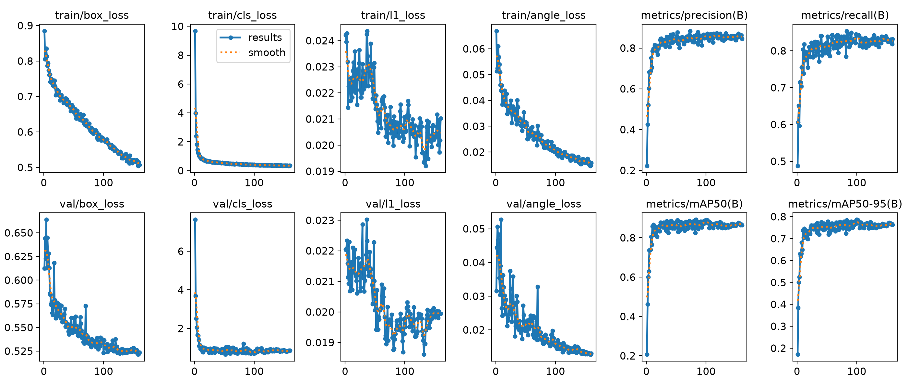
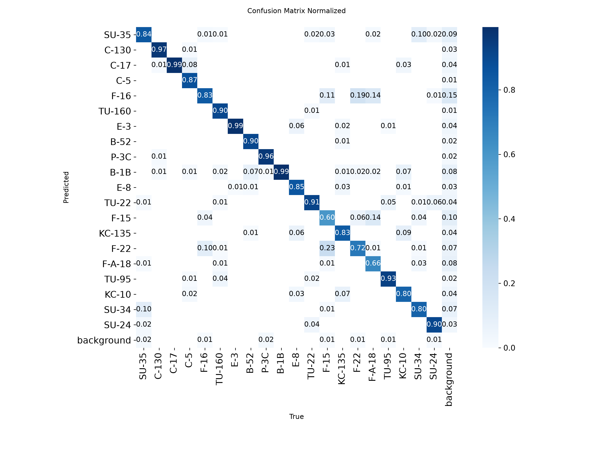
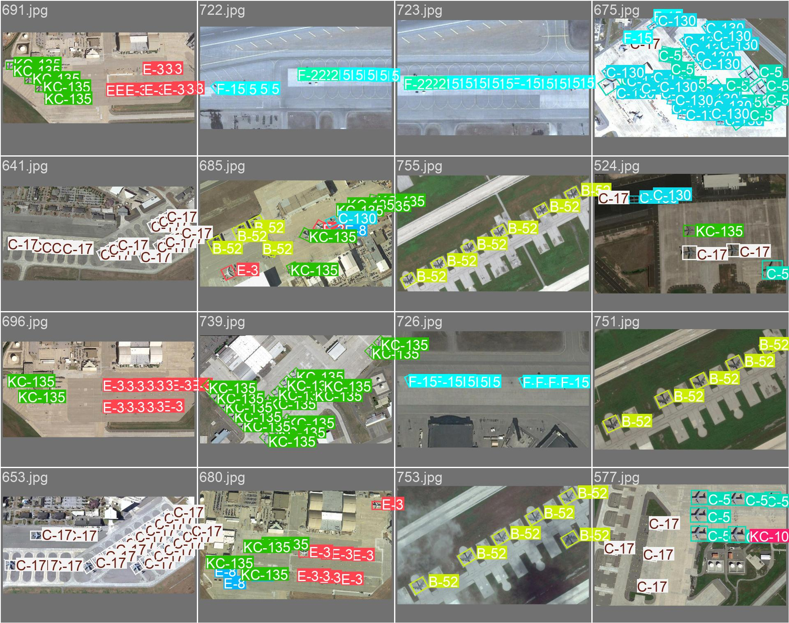
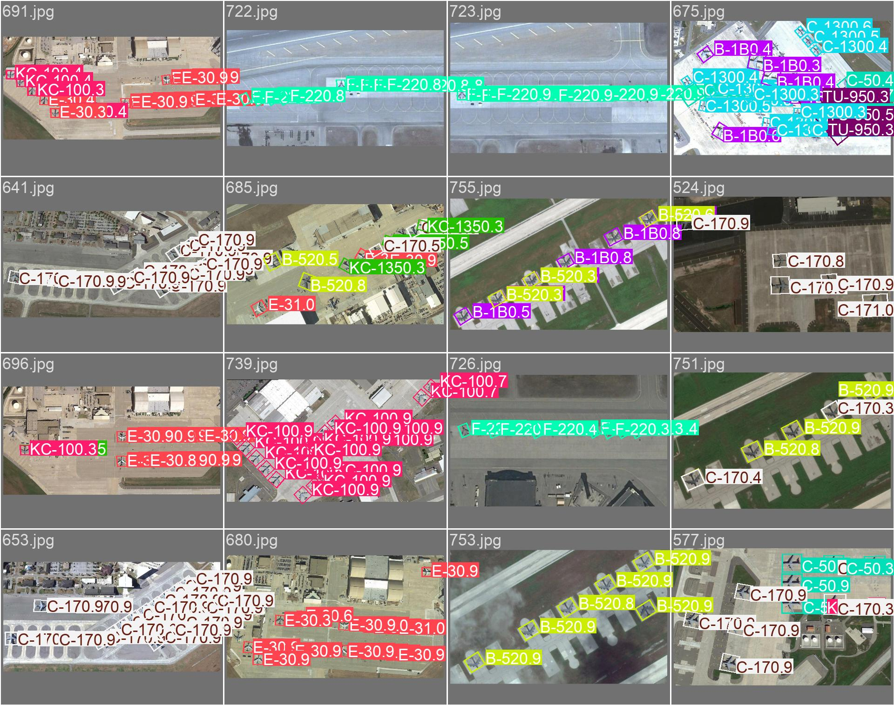
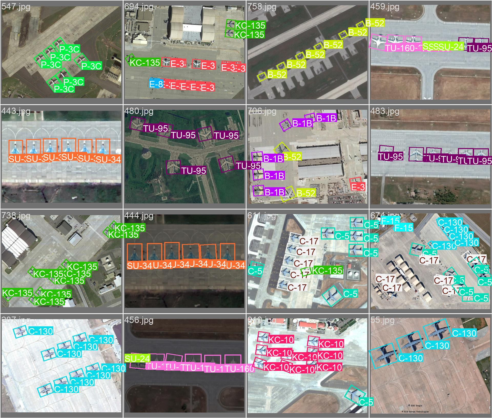
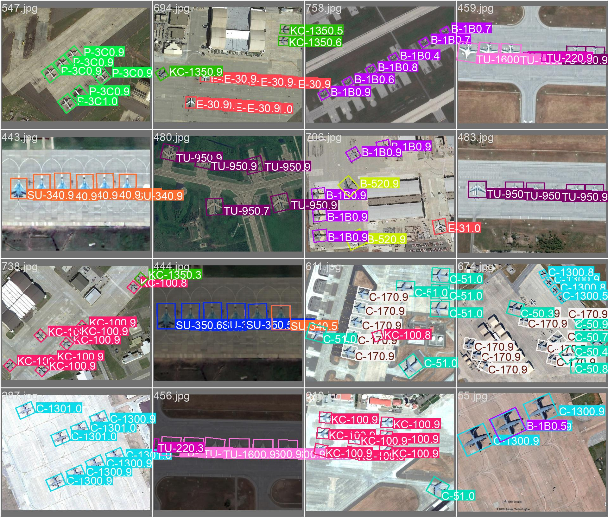
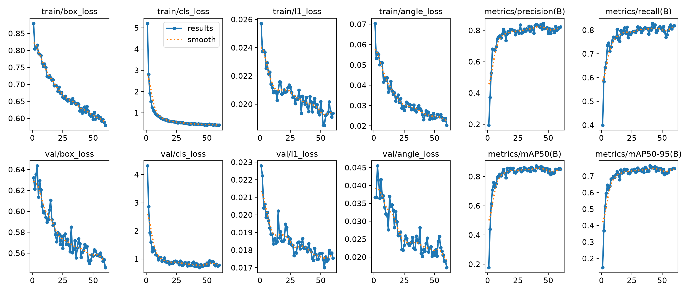
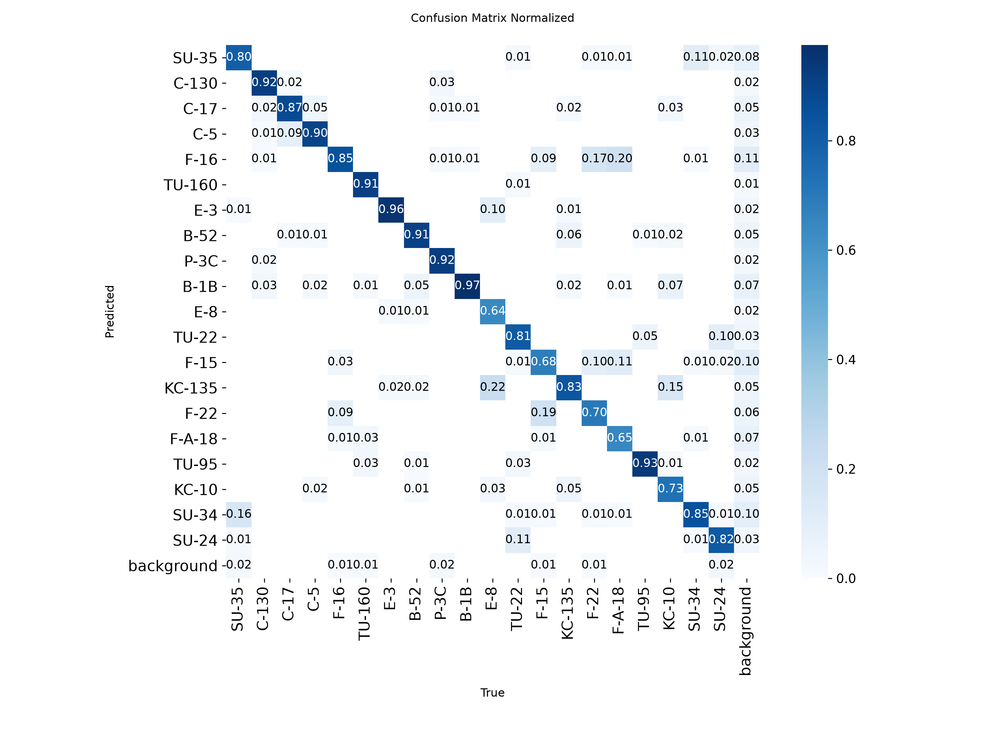

# 🛰️ SAT-TRACK – Satellite Military Aircraft Detection & Tracking

**Oriented bounding box detection of 20 military aircraft classes in overhead satellite imagery using YOLO26-OBB (nano, small, and a 1024 px rotation-augmented small model benchmarked).**

[](https://docs.ultralytics.com/tasks/obb/)
[](https://github.com/username/MAR20)
[](LICENSE)

---

## Overview

SAT-TRACK detects and classifies military aircraft in satellite images using oriented bounding boxes (OBB). Unlike horizontal bounding boxes, OBB captures the exact orientation of parked aircraft – critical for airbase monitoring, fleet counting, and activity assessment.

**20 classes** spanning US, Russian, and allied air forces: fighters (F-15, F-16, F-22, F/A-18, SU-34, SU-35), bombers (B-52, B-1B, TU-95, TU-160, TU-22), transports (C-5, C-17, C-130), tankers (KC-135, KC-10), AWACS (E-3, E-8), and maritime patrol (P-3C).

---

## Dataset

| Property | Value |
|----------|-------|
| Source | [MAR20](https://github.com/username/MAR20) |
| Images | 3,842 satellite images |
| Resolution | ~0.3–0.5 m/px (varies) |
| Classes | 20 military aircraft |
| Annotations | Oriented bounding boxes (DOTA format) |
| Train / Val | 1,331 / 2,511 (predefined split, no airfield overlap) |

### Classes

| US / Allied | Russian |
|-------------|---------|
| C-130, C-17, C-5, KC-135, KC-10 | SU-35, SU-34, SU-24 |
| E-3, E-8, P-3C | TU-160, TU-95, TU-22 |
| F-16, F-15, F-22, F/A-18, B-52, B-1B | – |

---

## Quick Start

```bash
# Install (a local virtualenv keeps this tidy)
python3 -m venv .venv && source .venv/bin/activate
pip install -r requirements.txt

# Dataset conversion only (no training)
python train_yolo_obb.py --setup-only

# Validate (uses the newest run found, or --model to pick one)
python test_model.py --val
python test_model.py --model runs/obb/mar20_yolo26s_train/weights/best.pt --val

# Predict on a single image
python test_model.py --image 42 --show

# Predict entire folder
python test_model.py --dir ./my_images/
```

### Reproducing the reported runs

These are the **exact** commands behind the numbers in Validation Results. Everything not passed on the
command line stays at the script defaults (`optimizer: auto`, `amp: true`, `seed: 0`,
`deterministic: true`, `close_mosaic: 10`, no cosine LR schedule).

```bash
# YOLO26n-OBB  ->  runs/obb/mar20_yolo26n_train   (trained on RTX 4070 12 GB)
python train_yolo_obb.py --model yolo26n-obb.pt --epochs 200 --batch 16 \
    --imgsz 640 --device 0 --workers 4

# YOLO26s-OBB  ->  runs/obb/mar20_yolo26s_train   (trained on NVIDIA L40S 48 GB)
python train_yolo_obb.py --model yolo26s-obb.pt --epochs 200 --batch 16 \
    --imgsz 640 --device 0 --workers 8

# YOLO26s-OBB @ 1024 + rotation  ->  runs/obb/mar20_yolo26s_l40s_1024   (current model, L40S)
python train_yolo_obb.py --model yolo26s-obb.pt --epochs 200 --patience 60 \
    --imgsz 1024 --batch 32 --device 0 --workers 16 \
    --cache ram --degrees 180 --cos-lr --name mar20_yolo26s_l40s_1024
```

Two defaults matter for reproduction:

- **`--epochs` defaults to 100**, so it must be passed explicitly. The reported runs used 200.
- **`--patience` defaults to 20 and was left there.** Neither run used `--patience 60`, and neither
  used `--cos-lr`.

The only difference between the two runs besides the checkpoint is `--workers` (4 vs 8, dataloader
only, no effect on the model), so the n → s comparison is controlled.

> `--patience 60 --cos-lr` appears in Next Steps as a **proposal for future runs** (the early stop at
> high LR is a known weakness of the current s run). It is not the configuration that produced the
> results above, and no run has used it yet.

### Resolved hyperparameters (identical for both runs)

Dumped from each run's `args.yaml`:

| Group | Values |
|-------|--------|
| Schedule | `lr0 0.01`, `lrf 0.01`, `momentum 0.937`, `weight_decay 0.0005`, `warmup_epochs 3.0`, `cos_lr false` |
| Loss | `box 7.5`, `cls 0.5`, `dfl 1.5`, `nbs 64` |
| Val / inference | `iou 0.7`, `max_det 300`, `conf null` |
| Geometry aug | `degrees 0.0`, `translate 0.1`, `scale 0.5`, `shear 0.0`, `perspective 0.0` |
| Flip / mosaic | `flipud 0.0`, `fliplr 0.5`, `mosaic 1.0`, `mixup 0.0`, `cutmix 0.0`, `copy_paste 0.0` |
| Photometric | `hsv_h 0.015`, `hsv_s 0.7`, `hsv_v 0.4`, `erasing 0.4`, `auto_augment randaugment` |

### L40S configuration (reported run)

The first YOLO26s run left the L40S idle: no image cache, `mosaic: 1.0` forcing ~4 JPEG decodes per
sample (~5,400 per epoch), `batch 16` at 640 on a 48 GB card, and `imgsz 640` against 734–800 px source
imagery. It managed ~16 s/epoch, dataloader-bound at roughly 30% GPU utilisation.

The throughput fix plus the resolution/augmentation change, which is the run reported below:

```bash
python train_yolo_obb.py --model yolo26s-obb.pt --epochs 200 --patience 60 \
    --imgsz 1024 --batch 32 --device 0 --workers 16 \
    --cache ram --degrees 180 --cos-lr --name mar20_yolo26s_l40s_1024
```

| Flag | Effect measured |
|------|-----------------|
| `--cache ram` | Removed per-epoch decode; 1,331 images at ~800 px fit in well under 1 GB |
| `--workers 16` | Loader kept up; GPU went from ~30% to 89–100% utilisation, 326 W of a 350 W TDP |
| `--batch 32 --imgsz 1024` | 25.7 GB resident of 46 GB, 26.9 s/epoch |
| `--degrees 180` | Rotation augmentation (every earlier run used `degrees: 0.0`) |
| `--cos-lr --patience 60` | Cosine tail; best fitness at epoch 100, stopped at 160 |

Measured throughput, and why it is not a fair fight against the old config:

| Run | Images/s | Pixel/s |
|-----|----------|---------|
| 640 @ batch 16, `cache: false` | ~103 | ~42 Mpixel/s |
| 1024 @ batch 32, `cache: ram` | ~105 | ~110 Mpixel/s |

Same images per second while each image carries 2.56× the pixels. The GPU utilisation figures
(`nvidia-smi`) measure kernel residency, not FLOP occupancy: this config still sits around 5% MFU,
which is expected for a 10.5 M-parameter detector.

Not a like-for-like comparison with the 640 px results, and reported as a separate row.

### YOLO26 OBB checkpoints

| Size | Checkpoint |
|------|------------|
| nano | `yolo26n-obb.pt` |
| small | `yolo26s-obb.pt` |
| medium | `yolo26m-obb.pt` |
| large | `yolo26l-obb.pt` |
| x-large | `yolo26x-obb.pt` |

YOLO26-OBB removes DFL regression and runs **NMS-free end-to-end** inference, so post-processing cost no
longer scales with the number of boxes. That matters here: dense airfields generate hundreds of
overlapping OBBs, exactly where NMS dominates latency.

---

## Validation Results

> **Current model:** `runs/obb/mar20_yolo26s_l40s_1024` – YOLO26s-OBB trained at 1024 with rotation
> augmentation. Validated with
> `python test_model.py --model runs/obb/mar20_yolo26s_l40s_1024/weights/best.pt --val`
> (the script reads `imgsz` from the run's `args.yaml`) over all 2,511 val images:
> **mAP@0.5 0.892 / mAP@0.5:0.95 0.786**, P 0.865, R 0.840.

### Benchmark across scales and input size

Rows 1–2 are the 640 px sweep: same split, same input, same decoder, same hyperparameters, only backbone
scale changes (training hardware differs, RTX 4070 for n and L40S for s). Row 3 changes input resolution
and augmentation as well, so it is not a like-for-like scale comparison.

| Model | Input | Params | mAP@0.5 | mAP@0.5:0.95 | Precision | Recall | Inference |
|-------|-------|--------|---------|--------------|-----------|--------|-----------|
| YOLO26n-OBB | 640 | 2.65 M | 0.858 | 0.749 | 0.828 | 0.790 | 1.6 ms |
| YOLO26s-OBB | 640 | 10.54 M | 0.873 | 0.762 | 0.839 | 0.808 | 3.1 ms |
| **YOLO26s-OBB + rot aug** | **1024** | 10.54 M | **0.892** | **0.786** | **0.865** | **0.840** | – |

YOLO26s at 640 wins on every metric against its smaller sibling. Going from nano to small (4× the
parameters) buys **+0.0146 mAP@0.5** and **+0.0126 mAP@0.5:0.95**, and it beats YOLO26n outright rather
than only on box quality.

Raising the input to 1024 and enabling rotation augmentation on the same backbone buys a further
**+0.019 mAP@0.5** and **+0.024 mAP@0.5:0.95** over the 640 run, which is more than the entire n → s
scale-up delivered. That is the pixel-budget hypothesis in Why the Fighter Gap Exists paying off, not
another width step. Its inference latency is not listed because it has not been timed on the RTX 4070
reference card yet; on the L40S it validates at ~6.0 ms/image.

### YOLO26s run details

**Image size:** 640×640  
**Epochs:** 200 configured – early-stopped at 60, best fitness at epoch 40 (held by `best.pt`), `patience: 20`  
**Batch:** 16 · **Train / Val:** 1,331 / 2,511 images  
**Hardware:** NVIDIA L40S (48 GB, Ada Lovelace, cloud instance at `/workspace/SAT-TRACK`) – ~15 s/epoch,
~16 min total. The YOLO26n run was trained on a local **RTX 4070 (12 GB)** instead.

Inference was timed on an RTX 4070 (not on the L40S): **3.1 ms model inference / 5.8 ms per image
end-to-end** (1.1 ms pre-process, 0.0 ms NMS, 1.6 ms post-process). Still NMS-free, so post-processing
stays flat as detections per tile grow.

### YOLO26s @ 1024 run details

**Image size:** 1024×1024 · **Rotation augmentation:** `degrees 180`  
**Epochs:** 200 configured – stopped at 160 by `patience 60`; best fitness at epoch 100 (held by `best.pt`)  
**Batch:** 32 · **Cache:** ram · **Workers:** 16 · **cos_lr:** enabled · **Train / Val:** 1,331 / 2,511  
**Hardware:** NVIDIA L40S (46 GB usable, 192 vCPU host) – 26.9 s/epoch, 72 min total, peak 25.7 GB VRAM  
**Utilisation:** 89–100% `nvidia-smi`, 326 W of 350 W TDP, SM clock pinned at 2505/2520 MHz  
**Checkpoints:** intermediate ones deleted during the run to stay inside a 10 GB volume; `best.pt` retained

### YOLO26s vs. YOLO26n

Raw 4-decimal values from each run's own validation pass.

| Metric | YOLO26n-OBB | YOLO26s-OBB | Δ |
|--------|-------------|-------------|---|
| mAP@0.5 | 0.8582 | 0.8728 | **+0.0146** |
| mAP@0.5:0.95 | 0.7495 | 0.7621 | **+0.0126** |
| Precision | 0.8283 | 0.8379 | +0.0096 |
| Recall | 0.7906 | 0.8085 | +0.0179 |
| Inference | 1.6 ms | 3.1 ms | +1.5 ms |

Scaling did not just move the average – it changed which classes work. Deltas vs. YOLO26n:

- **Gained:** F-22 +0.119 (0.500 → 0.619), B-52 +0.078, SU-35 +0.057, F-15 +0.039, F-16 +0.033,
  SU-34 +0.033, TU-160 +0.028, C-17 +0.025.
- **Lost:** KC-10 −0.084 (0.801 → 0.717), KC-135 −0.041, E-3 −0.015, TU-22 −0.012, F/A-18 −0.011,
  C-5 −0.011.
- 12 of 20 classes improved by more than 0.01; 6 regressed by more than 0.01.

### YOLO26s @ 1024 vs @ 640, per class

Same backbone, same data, same seed. Input resolution and rotation augmentation are the only changes.

| Class | mAP50 @640 | mAP50 @1024 | Δ | P @1024 | R @1024 |
|-------|-----------|-------------|---|---------|---------|
| B-52 | 0.948 | **0.987** | **+0.039** | 0.989 | 0.896 |
| B-1B | 0.977 | 0.986 | +0.009 | 0.831 | 0.996 |
| C-17 | 0.959 | 0.986 | **+0.027** | 0.932 | 0.986 |
| C-130 | 0.967 | 0.981 | +0.014 | 0.982 | 0.932 |
| E-3 | 0.957 | 0.980 | **+0.023** | 0.939 | 0.990 |
| C-5 | 0.907 | 0.970 | **+0.063** | 0.993 | 0.861 |
| TU-160 | 0.968 | 0.969 | +0.001 | 0.980 | 0.891 |
| P-3C | 0.958 | 0.968 | +0.010 | 0.970 | 0.944 |
| TU-95 | 0.970 | 0.955 | −0.015 | 0.969 | 0.910 |
| TU-22 | 0.868 | 0.936 | **+0.068** | 0.841 | 0.903 |
| SU-24 | 0.831 | 0.927 | **+0.096** | 0.936 | 0.877 |
| KC-135 | 0.901 | 0.925 | **+0.024** | 0.961 | 0.799 |
| SU-35 | 0.902 | 0.914 | +0.012 | 0.873 | 0.825 |
| SU-34 | 0.854 | 0.851 | −0.003 | 0.814 | 0.801 |
| E-8 | 0.789 | 0.847 | **+0.058** | 0.850 | 0.815 |
| F/A-18 | 0.881 | 0.840 | **−0.041** | 0.974 | 0.556 |
| F-16 | 0.746 | 0.821 | **+0.075** | 0.699 | 0.805 |
| KC-10 | 0.717 | 0.774 | **+0.057** | 0.554 | 0.804 |
| F-15 | 0.735 | 0.617 | **−0.118** | 0.723 | 0.521 |
| F-22 | 0.619 | 0.600 | −0.019 | 0.493 | 0.687 |

**13 of 20 improved by more than 0.01, 4 regressed.** The gains are concentrated where the pixel budget
was the binding constraint: SU-24 +0.096, F-16 +0.075, TU-22 +0.068, C-5 +0.063, E-8 +0.058, KC-10 +0.057.
Big airframes were already near ceiling (B-1B, TU-160, C-130 barely move).

The one real regression is **F-15: −0.118**, and it is an operating-point shift rather than a capability
loss. At 1024 the model becomes far more conservative on Eagle (P 0.723 / R 0.521 versus 0.772 / 0.635 at
640). F/A-18 does the same thing (P 0.974 / R 0.556). Both are recall-limited at the default operating
point, so per-class confidence calibration is the cheap fix, not more training.

F-22 remains the weakest class at 0.600 (P 0.493 / R 0.687), unchanged by resolution. Raptor is
low-precision rather than low-recall: the model finds them but over-predicts, which is consistent with its
planform being nearly interchangeable with other twin-tail fighters at this ground sample distance.

### Measurement caveats (read before quoting numbers)

- **One run per scale.** No seed averaging, so the n → s gap of +0.0146 is a single observation.
- **Epoch-to-epoch jitter is ±0.014** (std of s's mAP@0.5 over epochs 20–60 is 0.0138, range 0.813–0.873).
  The n → s gain is roughly one sigma. Treat it as "s is at least as good and probably a little better",
  not as a settled 1.5-point win.
- **`best.pt` was selected as the best epoch on this same val split**, so it carries selection optimism.
  A held-out test set (MAR20's split is reused as val here) is what would settle it.
- **s was early-stopped while still at high LR** (`cos_lr: false`, schedule spans the configured 200 epochs;
  LR at stop was ~0.0003 vs 0.00014 at start). Early stopping fired at epoch 60 with `patience: 20` and
  best fitness at epoch 40. It never got a low-LR refinement tail, so it is likely not fully converged.
- **Both 640 runs used `patience: 20` and `cos_lr: false`** — the script defaults. See "Reproducing the
  reported runs" for the exact commands.
- **The 1024 run used `patience: 60` and `cos_lr: true`**, and stopped at epoch 160 with best fitness at
  epoch 100. The 0.892 / 0.786 figures are that epoch's weights, again selected on the same val split, so
  the same selection optimism applies.
- **Single seed for the 1024 run too.** The +0.019 mAP50 gain over 640 is one observation. Its epoch-to-epoch
  jitter over epochs 100–160 is comparable in size to the gains it claims on individual classes, so the
  aggregate +0.019 is solid while the per-class deltas above ±0.05 should be treated as indicative.
- **Input-size caveat:** the 1024 model was validated at 1024 because `test_model.py` now reads
  `imgsz` from the run's `args.yaml`. Scoring it at 640 understates it, and the reverse also holds: do not
  compare its numbers against the 640 rows without noting the input size.
- **All numbers come from `args.yaml`-recorded runs** (`mar20_yolo26n_train`, `mar20_yolo26s_train`,
  `mar20_yolo26s_l40s_1024`), so hyperparameters are auditable rather than asserted.
- **Different training hardware.** YOLO26n was trained on an RTX 4070 (12 GB), YOLO26s on an NVIDIA L40S
  (48 GB). Hyperparameters are identical, and training hardware does not change the weights'
  quality, but cuDNN/cuBLAS kernel selection means `seed: 0` + `deterministic: true` does **not** give
  bit-identical reproduction across GPUs. Expect ±1e-3 wobble in the metrics on a different card, not zero.
- **Latency is not a controlled comparison.** The inference column (1.6 ms vs 3.1 ms) was timed on an
  RTX 4070 for both checkpoints, but s was *trained* on the L40S. That is fine for a like-for-like
  timing (both timed on the same card), yet it means no training-time throughput figure here is
  comparable – the Jetson benchmark exists precisely to produce a single-common-device latency table.

### Training Curves (1024 run)



### Confusion Matrix (1024 run)



### Validation Predictions (1024 run)

| Ground Truth | Predictions |
|-------------|-------------|
|  |  |
|  |  |

### Training Curves (640 run, for comparison)



### Confusion Matrix (640 run)



---

## Per-Class Breakdown (YOLO26s-OBB)

Classes ordered by mAP@0.5, with the YOLO26n result for reference. This breakdown is the **640 px** run;
for the 1024 px run see the comparison table above.

### 🟢 Strong (mAP50 ≥ 0.90) – Large, Distinct Airframes

| Class   | mAP50 | Precision | Recall | n mAP50 | Notes |
|---------|-------|-----------|--------|---------|-------|
| B-1B    | 0.977 | 0.876     | 0.964  | 0.979   | Lancer – swing-wing, best recall of the fleet |
| TU-95   | 0.970 | 0.959     | 0.914  | 0.957   | Bear – swept wings + 4 turboprops |
| TU-160  | 0.968 | 0.989     | 0.910  | 0.940   | Blackjack – largest combat aircraft |
| C-130   | 0.967 | 0.977     | 0.885  | 0.948   | Hercules – recall up 0.816 → 0.885 |
| C-17    | 0.959 | 0.909     | 0.878  | 0.934   | Globemaster III – tight, reliable boxes |
| P-3C    | 0.958 | 0.966     | 0.858  | 0.945   | Orion – long fuselage + 4-engine prop |
| E-3     | 0.957 | 0.910     | 0.947  | 0.972   | AWACS – rotodome unmistakable from above |
| B-52    | 0.948 | 0.877     | 0.898  | 0.870   | Stratofortress – biggest gain of the big airframes (+0.078) |
| C-5     | 0.907 | 0.813     | 0.875  | 0.918   | Galaxy – massive T-tail airlifter |
| SU-35   | 0.902 | 0.870     | 0.808  | 0.845   | Flanker-E – crossed 0.90, both P and R up vs. n |
| KC-135  | 0.901 | 0.892     | 0.807  | 0.942   | Stratotanker – slipped vs. n, still above 0.90 |

> 11/20 classes above 0.90 mAP50 – bombers, transports, AWACS, maritime patrol, and now SU-35.

### 🟡 Moderate (0.80–0.90)

| Class  | mAP50 | Precision | Recall | n mAP50 | Notes |
|--------|-------|-----------|--------|---------|-------|
| F/A-18 | 0.881 | 0.967     | 0.599  | 0.892   | Hornet – near-perfect precision, still misses ~40% |
| TU-22  | 0.868 | 0.829     | 0.773  | 0.880   | Backfire – swing-wing bomber |
| SU-34  | 0.854 | 0.720     | 0.856  | 0.821   | Fullback – good recall, precision is the weak half |
| SU-24  | 0.831 | 0.866     | 0.773  | 0.819   | Fencer – variable-sweep wing |

### 🟠 Weak (0.70–0.80)

| Class  | mAP50 | Precision | Recall | n mAP50 | Notes |
|--------|-------|-----------|--------|---------|-------|
| E-8    | 0.789 | 0.929     | 0.586  | 0.788   | JSTARS – flipped to conservative: P 0.745 → 0.929, R 0.675 → 0.586 |
| F-16   | 0.746 | 0.584     | 0.822  | 0.713   | Falcon – finds them, over-predicts (P 0.584) |
| F-15   | 0.735 | 0.772     | 0.635  | 0.696   | Eagle – improved on both axes, still recall-limited |
| KC-10  | 0.717 | 0.518     | 0.730  | 0.801   | Extender – worst regression vs. n (−0.084), now the weakest tanker |

### 🔴 Poor (<0.70)

| Class  | mAP50 | Precision | Recall | n mAP50 | Notes |
|--------|-------|-----------|--------|---------|-------|
| F-22   | 0.619 | 0.546     | 0.644  | 0.500   | Raptor – left the coin-flip floor (+0.119), still the worst class |

> **What scaling actually fixed:** the class ranking barely changed, but the floor moved. F-22 went from
> 0.500 to 0.619 and F-15/F-16 both improved, so the small backbone's worst failures are no longer total.
> What it did not fix: the fighter family is still the only block below 0.80 (except E-8/KC-10), and
> F/A-18's recall (0.599) shows the model is still conservative on dense fighter clusters.
>
> **What it cost:** KC-10 (−0.084) and KC-135 (−0.041) regressed. Both are 707-derived trijets seen from
> above and are the most likely casualty of the wider model's extra capacity being spent elsewhere.

---

## Why the Fighter Gap Exists

1. **Planform similarity** – all modern fighters are single/double-seat, swept-wing, single/double-tail. The difference between an F-16 and SU-35 from 800 km up is a few pixels of wing sweep.
2. **Scale** – fighters are 15–20 m long. At 0.3–0.5 m/px, they occupy ~30×30 pixels at 640×640 input. That pixel budget is the binding constraint, not model size: n → s quadrupled the parameters and moved F-15 from 0.696 to 0.735 and F-16 from 0.713 to 0.746, when a true capacity limit would have moved them much further.
3. **Feature asymmetry** – the model learns strong features for bombers (wing config, engine count, size) that don't exist for fighters.
4. **Not data starvation** – correlation between class instance count and mAP@0.5 is only **0.13**. F-22 has 418 val instances and scores 0.619; TU-160 has 334 and scores 0.968. The difference tracks how distinguishable the airframe is, not how many examples exist.

Two configuration gaps that made the gap worse than it had to be, both now tested:

- **No rotation augmentation.** Earlier runs used `degrees: 0.0`, forcing the model to learn rotation
  invariance from `fliplr`/`scale`/`mosaic` alone even though overhead aircraft sit at arbitrary azimuth.
- **No resolution headroom.** Every earlier run was 640×640, where a fighter occupies ~30×30 px. At 1024 it
  gets ~48×48 px (2.5× the pixel area).

Both were fixed together in the 1024 run, and the gap moved where the theory said it would: F-16 +0.075,
SU-24 +0.096, TU-22 +0.068, KC-10 +0.057, while the already-strong airframes hardly changed. It did not
close the gap outright, which is the useful negative result: F-22 is still 0.600 and F-15 regressed to
0.617. Resolution helps the classes that were *slightly* under-resolved; it does not rescue the ones that
are fundamentally ambiguous at this ground sample distance.

---

## Architecture Strategy

**Phase 1 – Scale up YOLO26-OBB:** done for n and s. YOLO26s-OBB (10.54 M params): mAP@0.5 0.873 /
mAP@0.5:0.95 0.762 at 640, beating YOLO26n on every metric and lifting F-22 from 0.500 to 0.619.
Fighters still cap the average – the class mean excluding F-15/F-16/F-22-type failures is ~0.91.

**Phase 2 – Resolution and augmentation:** done. `imgsz 1024` plus `degrees 180`, `patience 60` and
`cos_lr` bought **+0.019 mAP@0.5 / +0.024 mAP@0.5:0.95** over 640, more than the whole n → s scale-up.
F-16, SU-24, TU-22, C-5, E-8 and KC-10 all gained 0.057 to 0.096; F-15 regressed 0.118 on recall.

**Phase 3 – Edge deployment and benchmarking:** the 1024 checkpoint is the final model. Next step is
deploying it to an **NVIDIA Jetson Orin Nano 8GB** and benchmarking on-device performance (see Edge
Deployment below). Note the deployment target is a 8 GB shared-memory module while the model was trained
at 1024; FP16 TensorRT at batch 1 is the variant most likely to fit comfortably.

| Stage       | Model                          | Role                                              | Status        |
|-------------|--------------------------------|---------------------------------------------------|---------------|
| Scaled      | YOLO26n-OBB                    | NMS-free head, small-object regression            | ✅ mAP50 0.858 / 0.749 |
| Scaled      | YOLO26s-OBB @ 640              | Width step over nano                              | ✅ mAP50 0.873 / 0.762 |
| **Current** | **YOLO26s-OBB @ 1024 + rot aug** | **Final model: resolution + rotation**          | ✅ **mAP50 0.892 / 0.786** |
| Deployment  | YOLO26s-OBB on Jetson Orin Nano | TensorRT export, on-device benchmark + paper      | ⬜ Next |

---

## Edge Deployment (Jetson Orin Nano 8GB)

The trained 1024 px YOLO26s-OBB checkpoint is the deliverable; the deployment target is an NVIDIA Jetson
Orin Nano 8GB (Ampere, 1024-core GPU, 6-core ARM Cortex-A78AE, 8 GB shared LPDDR5 at 68 GB/s).

Planned benchmark matrix – same 2,511-image val split, accuracy must match the desktop numbers
(RTX 4070 reference timings above; the L40S was training-only).

| Variant | What it measures |
|---------|------------------|
| PyTorch FP32 (`best.pt`) | Baseline, no optimisation |
| ONNX Runtime | Export portability, CPU/GPU EP |
| TensorRT FP16 | Realistic edge latency |
| TensorRT INT8 (calibrated on MAR20) | Throughput ceiling vs. mAP loss |

Metrics to report per variant: per-image latency (pre/inference/post split), FPS at batch 1, mean
power draw and energy per frame (`jtop`), peak memory, thermal throttling over a sustained run, and
mAP@0.5 / mAP@0.5:0.95 parity against the desktop checkpoint.

---

## Next Steps

The training work is done: YOLO26s-OBB at 1024 with rotation augmentation is the final model at
**0.892 mAP@0.5 / 0.786 mAP@0.5:0.95**. What remains is deployment, evaluation hygiene, and writing.

1. **Export and benchmark on Jetson Orin Nano 8GB** – `best.pt` → ONNX → TensorRT FP16/INT8, measure
   latency, FPS, power, and memory per variant.
2. **Validate on-device accuracy parity** – run the same val split on the Jetson at 1024; any mAP loss from
   FP16/INT8 quantisation is the headline trade-off, and 8 GB of shared memory is the likely binding
   constraint before compute is.
3. **Write the short paper** – YOLO26s-OBB on MAR20 (640 → 1024 ablation plus the per-class table) and the
   Jetson Orin Nano benchmark suite (accuracy / latency / power), quoting the exact commands from
   "Reproducing the reported runs" and the measurement caveats above.
4. **Prove gains with seeds, not single runs** – every number here is one run. Re-run the 1024 config 2–3
   times with different seeds and report mean ± std before claiming the +0.019 is settled.
5. **Per-class confidence calibration** – the cheap, no-retraining win: F-15 (P 0.723 / R 0.521),
   F/A-18 (P 0.974 / R 0.556), KC-10 (P 0.554 / R 0.804) and E-8 (P 0.850 / R 0.815) are all sitting on a
   badly-placed operating point. Tune the conf threshold per class and re-report mAP.
6. **Optional: F-22 targeted work** – still the weakest class at 0.600 with precision 0.493, unchanged by
   resolution. More pixels did not help, so the remaining levers are hard-negative mining against the other
   twin-tail fighters or an upstream crop-and-reclassify stage, not another training run at this config.

---

## Files

| File | Purpose |
|------|---------|
| `train_yolo_obb.py` | Conversion + training. Defaults to `yolo26n-obb.pt`, `--epochs 100`, `--patience 20`, `--batch 16`, `--imgsz 640`. Also passes through `--cache`, `--cos-lr`, `--degrees`, `--close-mosaic`, `--lr0`, `--optimizer`, `--seed`, `--no-amp`, `--rect`; `--model` selects another YOLO26-OBB variant |
| `test_model.py` | Validation, single-image prediction, batch inference on any YOLO26-OBB checkpoint (`--model` to choose). Reads `imgsz` from the run's `args.yaml` (override with `--imgsz`) |
| `runs/obb/mar20_yolo26s_l40s_1024/` | **Current model** – YOLO26s-OBB @ 1024 with rotation augmentation. Curves, confusion matrix, val batches, `best.pt` (weights git-ignored) |
| `runs/obb/mar20_yolo26s_train/` | YOLO26s-OBB @ 640, kept for the 640 → 1024 comparison |
| `runs/obb/mar20_yolo26n_train/` | YOLO26n-OBB run, kept for the scale comparison |
| `logs/train_l40s_1024.log`, `logs/val_1024.txt` | Full training transcript and final validation output for the 1024 run |
| `runs/obb/val-3/` | Standalone validation output for the YOLO26s-OBB @ 640 checkpoint |
| `yolo_obb_dataset/mar20_obb.yaml` | Dataset config (auto-generated, path fixed to this checkout) |

---
*Built with [Ultralytics YOLO26](https://docs.ultralytics.com/) on the MAR20 dataset.*
