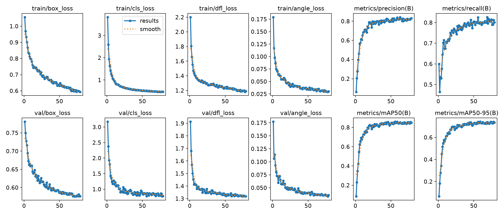
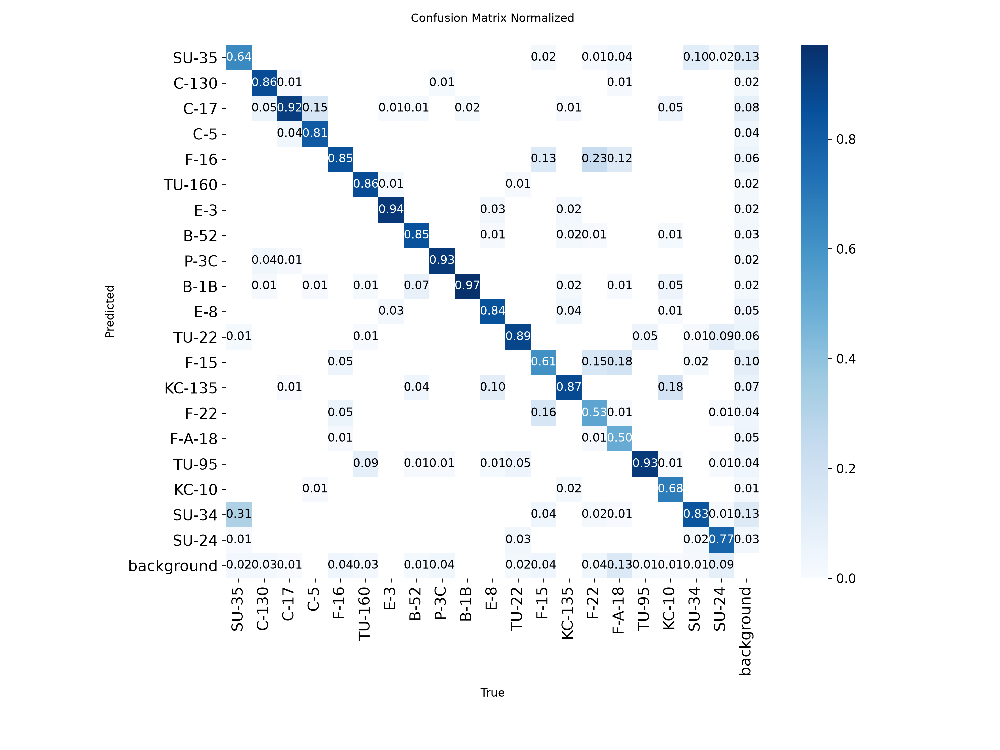
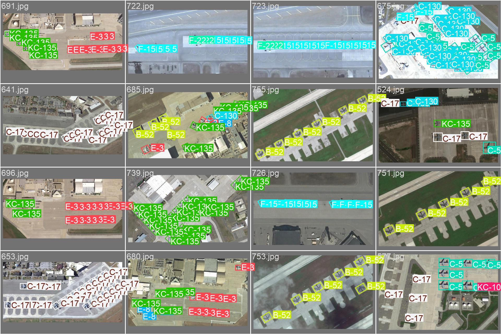
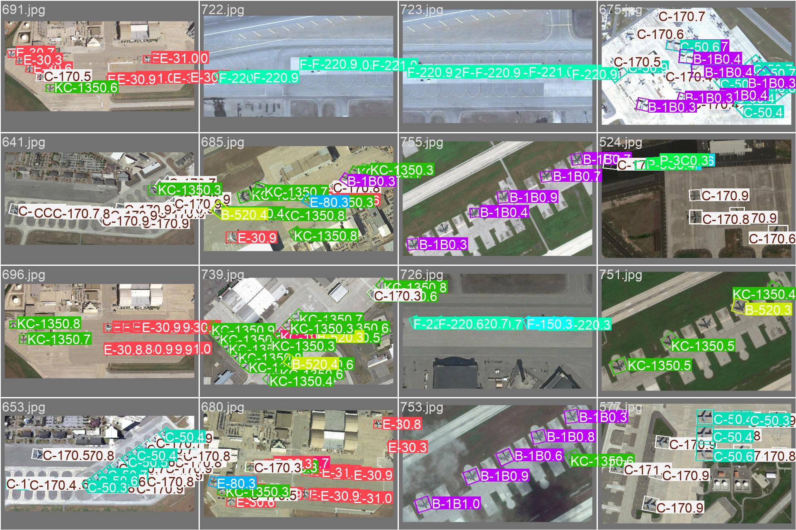
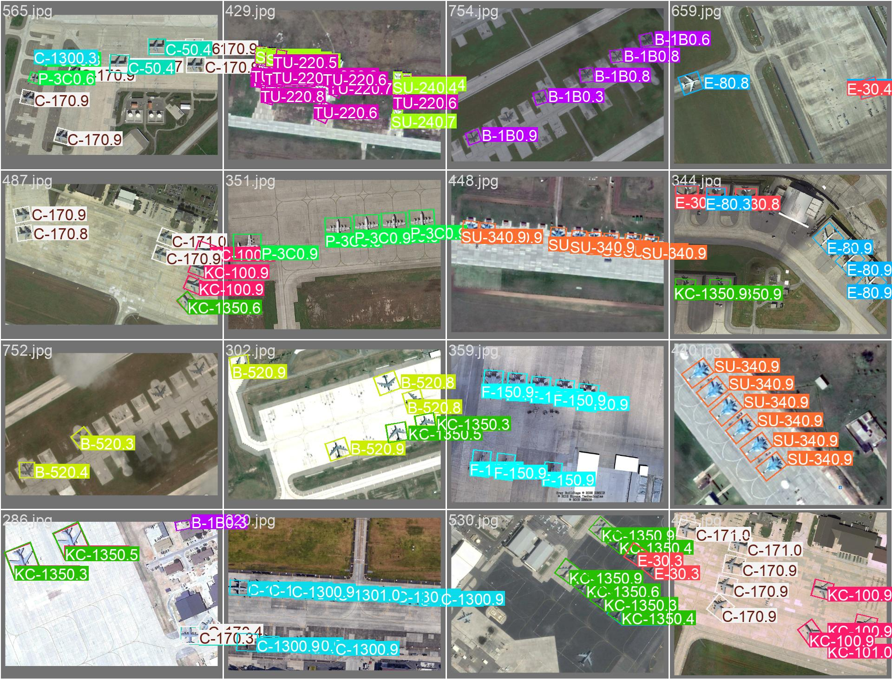

# 🛰️ SAT-TRACK – Satellite Military Aircraft Detection & Tracking

**Oriented bounding box detection of 20 military aircraft classes in overhead satellite imagery using YOLO11-OBB.**

[](https://docs.ultralytics.com/tasks/obb/)
[](#overall-performance)
[](https://github.com/username/MAR20)
[](LICENSE)

---

## Overview

SAT-TRACK detects and classifies military aircraft in satellite images using oriented bounding boxes (OBB). Unlike horizontal bounding boxes, OBB captures the exact orientation of parked aircraft – critical for airbase monitoring, fleet counting, and activity assessment.

**20 classes** spanning US, Russian, and allied air forces: fighters (F-15, F-16, F-22, F/A-18, SU-34, SU-35), bombers (B-52, B-1B, TU-95, TU-160, TU-22), transports (C-5, C-17, C-130), tankers (KC-135, KC-10), AWACS (E-3, E-8), and maritime patrol (P-3C).

---

## Dataset

| Property | Value |
|----------|-------|
| Source | [MAR20](https://github.com/username/MAR20) |
| Images | 3,842 satellite images |
| Resolution | ~0.3–0.5 m/px (varies) |
| Classes | 20 military aircraft |
| Annotations | Oriented bounding boxes (DOTA format) |
| Train / Val | 1,331 / 2,511 (predefined split, no airfield overlap) |

### Classes

| US / Allied | Russian |
|-------------|---------|
| C-130, C-17, C-5, KC-135, KC-10 | SU-35, SU-34, SU-24 |
| E-3, E-8, P-3C | TU-160, TU-95, TU-22 |
| F-16, F-15, F-22, F/A-18, B-52, B-1B | – |

---

## Quick Start

```bash
# Install
pip install ultralytics

# Validate
python test_model.py --val

# Predict on a single image
python test_model.py --image 42 --show

# Predict entire folder
python test_model.py --dir ./my_images/
```

---

## Validation Results – YOLO11n-OBB (Baseline)

**Model:** YOLO11n-OBB (nano, 2.6M params)  
**Image Size:** 640×640  
**Epochs:** 100 (early stopping at epoch 59)

### Overall Performance

| Metric    | Value  |
|-----------|--------|
| mAP@0.5   | 0.858  |
| mAP@0.5:0.95 | 0.741  |
| Precision | 0.836  |
| Recall    | 0.801  |

Inference: **1.4 ms/image** (NVIDIA GPU).

### Training Curves



### Confusion Matrix



### Validation Predictions

| Ground Truth | Predictions |
|-------------|-------------|
|  |  |
|  |  |

---

## Per-Class Breakdown

### 🟢 Strong (mAP50 ≥ 0.90) – Large, Distinct Airframes

| Class   | mAP50 | Precision | Recall | Notes |
|---------|-------|-----------|--------|-------|
| E-3     | 0.978 | 0.932     | 0.941  | AWACS – rotodome unmistakable from above |
| B-1B    | 0.976 | 0.869     | 0.977  | Lancer – swing-wing, near-perfect recall |
| TU-95   | 0.964 | 0.931     | 0.925  | Bear – swept wings + 4 turboprops |
| TU-160  | 0.958 | 0.953     | 0.856  | Blackjack – largest combat aircraft |
| P-3C    | 0.948 | 0.945     | 0.899  | Orion – long fuselage + 4-engine prop |
| C-5     | 0.936 | 0.918     | 0.824  | Galaxy – massive T-tail airlifter |
| KC-135  | 0.933 | 0.913     | 0.866  | Stratotanker – 707-derived, refueling boom |
| B-52    | 0.928 | 0.933     | 0.848  | Stratofortress – 8 engines, huge wingspan |
| C-17    | 0.924 | 0.813     | 0.952  | Globemaster III – finds nearly all of them |
| C-130   | 0.923 | 0.967     | 0.853  | Hercules – best precision in dataset |
| TU-22   | 0.906 | 0.752     | 0.896  | Backfire – swing-wing bomber |

> Bombers, transports, AWACS, and maritime patrol dominate – 11/20 classes above 0.90 mAP50.

### 🟡 Moderate (0.80–0.90)

| Class  | mAP50 | Precision | Recall | Notes |
|--------|-------|-----------|--------|-------|
| E-8    | 0.881 | 0.792     | 0.855  | JSTARS – 707 airframe, good despite fewer examples |
| SU-35  | 0.851 | 0.849     | 0.685  | Flanker-E – large fighter, decent precision, misses some |
| F/A-18 | 0.805 | 0.984     | 0.433  | Hornet – near-perfect precision, misses >50% |
| SU-24  | 0.802 | 0.919     | 0.764  | Fencer – variable-sweep wing |

### 🟠 Weak (0.75–0.80)

| Class  | mAP50 | Precision | Recall | Notes |
|--------|-------|-----------|--------|-------|
| KC-10  | 0.795 | 0.850     | 0.682  | Extender – tri-jet, likely confused with KC-135 |

### 🔴 Poor (<0.75) – Fighters

| Class  | mAP50 | Precision | Recall | Notes |
|--------|-------|-----------|--------|-------|
| SU-34  | 0.742 | 0.596     | 0.861  | Fullback – many false positives, cockpit invisible from above |
| F-16   | 0.735 | 0.637     | 0.834  | Falcon – low precision, over-predicts |
| F-15   | 0.676 | 0.657     | 0.565  | Eagle – weak on both precision and recall |
| F-22   | 0.500 | 0.520     | 0.510  | Raptor – near-random, worst class |

> **Fighter bottleneck:** From top-down satellite, F-15/16/22, F/A-18, SU-34/35 all appear as swept-wing deltas occupying ~30×30 pixels. F/A-18 is too conservative (P=0.984, R=0.433), while SU-34 and F-16 are too aggressive (low precision, conflating other fighters).

---

## Why the Fighter Gap Exists

1. **Planform similarity** – all modern fighters are single/double-seat, swept-wing, single/double-tail. The difference between an F-16 and SU-35 from 800 km up is a few pixels of wing sweep.
2. **Scale** – fighters are 15–20 m long. At 0.3–0.5 m/px, they occupy ~30×30 pixels. Distinguishing subtle airframe features at that resolution is beyond the nano backbone's capacity.
3. **Feature asymmetry** – the model learns strong features for bombers (wing config, engine count, size) that don't exist for fighters.

---

## Architecture Strategy

**Phase 1 – Scale up YOLO11-OBB:** The nano backbone likely lacks the receptive field to disambiguate fighter-sized airframes. Upgrading to medium or large should close the fighter gap *without* adding pipeline complexity.

**Phase 2 – EfficientNet-B4 fallback (conditional):** If fighters remain below 0.85 mAP50 after scaling, add a cropped re-classifier. YOLO handles detection; low-confidence fighter predictions are re-classified by EfficientNet-B4 on the cropped OBB region.

| Stage       | Model                          | Role                                              | Status        |
|-------------|--------------------------------|---------------------------------------------------|---------------|
| Baseline    | YOLO11n-OBB                    | Detect + classify all aircraft                    | ✅ mAP50 0.858 |
| Scale-up    | YOLO11m-OBB or YOLO11l-OBB     | Larger backbone – close the fighter gap           | ⬜ Next        |
| Fallback    | EfficientNet-B4                | Fighter re-classifier (conditional)               | ⬜ If needed   |

---

## Next Steps

1. **Train YOLO11m/l-OBB** – same data, compare fighter mAP50 vs nano.
2. **If fighter mAP50 still < 0.85:** train EfficientNet-B4 on cropped fighter instances.
3. **Add F-35, B-2, A-10** from MTARSI – fill gaps in the 20-class set.
4. **Wire fallback pipeline** – low-confidence fighters → crop OBB → EfficientNet-B4 → override.

---

## Files

| File | Purpose |
|------|---------|
| `train_yolo_obb.py` | Training script – converts MAR20 to YOLO OBB format, trains model |
| `test_model.py` | Validation, single-image prediction, batch inference |
| `runs/obb/mar20_train/weights/best.pt` | Trained weights (YOLO11n-OBB baseline) |
| `yolo_obb_dataset/mar20_obb.yaml` | Dataset config (auto-generated by training script) |

---
*Built with [Ultralytics YOLO11](https://docs.ultralytics.com/) on the MAR20 dataset.*
