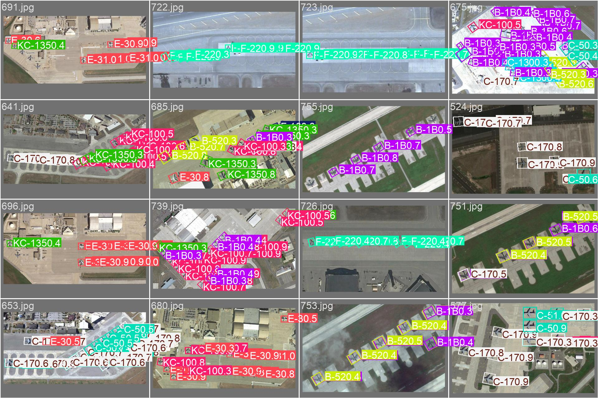
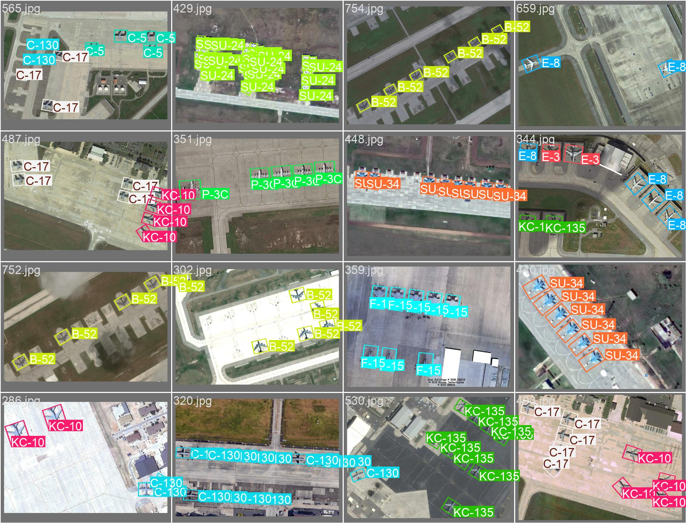
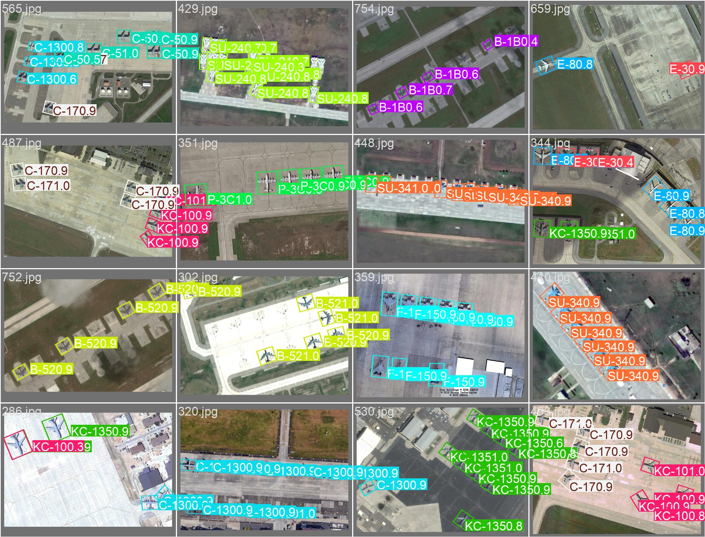

# 🛰️ SAT-TRACK – Satellite Military Aircraft Detection & Tracking

**Oriented bounding box detection of 20 military aircraft classes in overhead satellite imagery using YOLO26-OBB (nano and small scales benchmarked).**

[](https://docs.ultralytics.com/tasks/obb/)
[](https://github.com/username/MAR20)
[](LICENSE)

---

## Overview

SAT-TRACK detects and classifies military aircraft in satellite images using oriented bounding boxes (OBB). Unlike horizontal bounding boxes, OBB captures the exact orientation of parked aircraft – critical for airbase monitoring, fleet counting, and activity assessment.

**20 classes** spanning US, Russian, and allied air forces: fighters (F-15, F-16, F-22, F/A-18, SU-34, SU-35), bombers (B-52, B-1B, TU-95, TU-160, TU-22), transports (C-5, C-17, C-130), tankers (KC-135, KC-10), AWACS (E-3, E-8), and maritime patrol (P-3C).

---

## Dataset

| Property | Value |
|----------|-------|
| Source | [MAR20](https://github.com/username/MAR20) |
| Images | 3,842 satellite images |
| Resolution | ~0.3–0.5 m/px (varies) |
| Classes | 20 military aircraft |
| Annotations | Oriented bounding boxes (DOTA format) |
| Train / Val | 1,331 / 2,511 (predefined split, no airfield overlap) |

### Classes

| US / Allied | Russian |
|-------------|---------|
| C-130, C-17, C-5, KC-135, KC-10 | SU-35, SU-34, SU-24 |
| E-3, E-8, P-3C | TU-160, TU-95, TU-22 |
| F-16, F-15, F-22, F/A-18, B-52, B-1B | – |

---

## Quick Start

```bash
# Install (a local virtualenv keeps this tidy)
python3 -m venv .venv && source .venv/bin/activate
pip install -r requirements.txt

# Train YOLO26n-OBB on MAR20 (dataset auto-converted when raw MAR20 is present)
python train_yolo_obb.py

# Train the current best variant (YOLO26s-OBB, see Validation Results)
python train_yolo_obb.py --model yolo26s-obb.pt --epochs 200 --patience 60 --cos-lr

# Train a bigger YOLO26 variant
python train_yolo_obb.py --model yolo26m-obb.pt --epochs 200

# Dataset conversion only (no training)
python train_yolo_obb.py --setup-only

# Validate (uses the newest run found, or --model to pick one)
python test_model.py --val
python test_model.py --model runs/obb/mar20_yolo26s_train/weights/best.pt --val

# Predict on a single image
python test_model.py --image 42 --show

# Predict entire folder
python test_model.py --dir ./my_images/
```

### Cloud GPU training

There is one entry point for training: `train_yolo_obb.py`. It works unchanged on a cloud instance
(Colab, Kaggle, Lambda, RunPod) - point `--device` at the GPU index and it downloads the requested
checkpoint itself, so there is no weights file to upload:

```bash
git clone <this-repo> && cd SAT-TRACK
pip install -r requirements.txt

# dataset conversion happens automatically when the raw MAR20 tree is present
python train_yolo_obb.py --model yolo26s-obb.pt --epochs 200 --device 0 --batch 32 --workers 8
python train_yolo_obb.py --model yolo26m-obb.pt --epochs 200 --device 0 --batch 32 --workers 8
```

What that produces, per model, under `runs/obb/`:

| Path | Contents |
|------|----------|
| `runs/obb/mar20_<model>_train/` | `weights/`, `results.csv`, `args.yaml`, curves, confusion matrix, batch images |
| `runs/obb/val/` (then `val2`, `val3`, ...) | output of a later `python test_model.py --val` |

Run names are derived from the checkpoint (`yolo26s-obb.pt` -> `mar20_yolo26s_train`), so different
sizes never collide. Two things to know before downloading the results:

- **`exist_ok=True`** - re-running the same model **overwrites** its run dir. Use `--name mar20_yolo26s_v2`
  to keep an earlier attempt.
- **Checkpoints dominate the size.** `save_period=10` writes a full checkpoint every 10 epochs (~110 MB
  for s, ~245 MB for m each). Pull only `best.pt`, `results.csv`, and the PNGs; leave `weights/` behind.
  `*.pt` and `runs/obb/*/weights/` are git-ignored, so nothing large can slip into a commit.

### YOLO26 OBB checkpoints

| Size | Checkpoint |
|------|------------|
| nano | `yolo26n-obb.pt` |
| small | `yolo26s-obb.pt` |
| medium | `yolo26m-obb.pt` |
| large | `yolo26l-obb.pt` |
| x-large | `yolo26x-obb.pt` |

YOLO26-OBB removes DFL regression and runs **NMS-free end-to-end** inference, so post-processing cost no
longer scales with the number of boxes. That matters here: dense airfields generate hundreds of
overlapping OBBs, exactly where NMS dominates latency.

---

## Validation Results

> **Current model:** `runs/obb/mar20_yolo26s_train` – YOLO26s-OBB, validated with
> `python test_model.py --model runs/obb/mar20_yolo26s_train/weights/best.pt --val` over all 2,511 val images.

### Benchmark across scales

Same val split, same 640×640 input, same decoder – only the backbone scale changes.

| Model | Params | mAP@0.5 | mAP@0.5:0.95 | Precision | Recall | Inference |
|-------|--------|---------|--------------|-----------|--------|-----------|
| YOLO11n-OBB (baseline) | – | 0.859 | 0.742 | 0.837 | 0.801 | 1.4 ms |
| YOLO26n-OBB | 2.65 M | 0.858 | 0.749 | 0.828 | 0.790 | 1.6 ms |
| **YOLO26s-OBB** | 10.54 M | **0.873** | **0.762** | **0.839** | **0.808** | 3.1 ms |

YOLO26s wins on every metric. Going from nano to small (4× the parameters) buys **+0.0146 mAP@0.5** and
**+0.0126 mAP@0.5:0.95**, and it is the first variant that beats the original YOLO11n baseline outright
rather than only on box quality.

### YOLO26s run details

**Image size:** 640×640  
**Epochs:** 200 configured – early-stopped at 60, best fitness at epoch 40 (held by `best.pt`)  
**Batch:** 16 · **Device:** cloud GPU (~15 s/epoch, ~16 min total) · **Train / Val:** 1,331 / 2,511 images

Inference on RTX 4070: **3.1 ms model inference / 5.8 ms per image end-to-end** (1.1 ms pre-process,
0.0 ms NMS, 1.6 ms post-process). Still NMS-free, so post-processing stays flat as detections per tile grow.

### YOLO26s vs. YOLO26n

Raw 4-decimal values from each run's own validation pass.

| Metric | YOLO26n-OBB | YOLO26s-OBB | Δ |
|--------|-------------|-------------|---|
| mAP@0.5 | 0.8582 | 0.8728 | **+0.0146** |
| mAP@0.5:0.95 | 0.7495 | 0.7621 | **+0.0126** |
| Precision | 0.8283 | 0.8379 | +0.0096 |
| Recall | 0.7906 | 0.8085 | +0.0179 |
| Inference | 1.6 ms | 3.1 ms | +1.5 ms |

Scaling did not just move the average – it changed which classes work. Deltas vs. YOLO26n:

- **Gained:** F-22 +0.119 (0.500 → 0.619), B-52 +0.078, SU-35 +0.057, F-15 +0.039, F-16 +0.033,
  SU-34 +0.033, TU-160 +0.028, C-17 +0.025.
- **Lost:** KC-10 −0.084 (0.801 → 0.717), KC-135 −0.041, E-3 −0.015, TU-22 −0.012, F/A-18 −0.011,
  C-5 −0.011.
- 12 of 20 classes improved by more than 0.01; 6 regressed by more than 0.01.

### Measurement caveats (read before quoting numbers)

- **One run per scale.** No seed averaging, so the n → s gap of +0.0146 is a single observation.
- **Epoch-to-epoch jitter is ±0.014** (std of s's mAP@0.5 over epochs 20–60 is 0.0138, range 0.813–0.873).
  The n → s gain is roughly one sigma. Treat it as "s is at least as good and probably a little better",
  not as a settled 1.5-point win.
- **`best.pt` was selected as the best epoch on this same val split**, so it carries selection optimism.
  A held-out test set (MAR20's split is reused as val here) is what would settle it.
- **s was early-stopped while still at high LR** (`cos_lr: false`, schedule spans the configured 200 epochs;
  LR at stop was ~0.0003 vs 0.00014 at start). It never got a low-LR refinement tail, so it is likely not
  fully converged.

### Training Curves


### Confusion Matrix


### Validation Predictions

| Ground Truth | Predictions |
|-------------|-------------|
|  |  |
|  |  |

---

## Per-Class Breakdown (YOLO26s-OBB)

Classes ordered by mAP@0.5, with the YOLO26n result for reference.

### 🟢 Strong (mAP50 ≥ 0.90) – Large, Distinct Airframes

| Class   | mAP50 | Precision | Recall | n mAP50 | Notes |
|---------|-------|-----------|--------|---------|-------|
| B-1B    | 0.977 | 0.876     | 0.964  | 0.979   | Lancer – swing-wing, best recall of the fleet |
| TU-95   | 0.970 | 0.959     | 0.914  | 0.957   | Bear – swept wings + 4 turboprops |
| TU-160  | 0.968 | 0.989     | 0.910  | 0.940   | Blackjack – largest combat aircraft |
| C-130   | 0.967 | 0.977     | 0.885  | 0.948   | Hercules – recall up 0.816 → 0.885 |
| C-17    | 0.959 | 0.909     | 0.878  | 0.934   | Globemaster III – tight, reliable boxes |
| P-3C    | 0.958 | 0.966     | 0.858  | 0.945   | Orion – long fuselage + 4-engine prop |
| E-3     | 0.957 | 0.910     | 0.947  | 0.972   | AWACS – rotodome unmistakable from above |
| B-52    | 0.948 | 0.877     | 0.898  | 0.870   | Stratofortress – biggest gain of the big airframes (+0.078) |
| C-5     | 0.907 | 0.813     | 0.875  | 0.918   | Galaxy – massive T-tail airlifter |
| SU-35   | 0.902 | 0.870     | 0.808  | 0.845   | Flanker-E – crossed 0.90, both P and R up vs. n |
| KC-135  | 0.901 | 0.892     | 0.807  | 0.942   | Stratotanker – slipped vs. n, still above 0.90 |

> 11/20 classes above 0.90 mAP50 – bombers, transports, AWACS, maritime patrol, and now SU-35.

### 🟡 Moderate (0.80–0.90)

| Class  | mAP50 | Precision | Recall | n mAP50 | Notes |
|--------|-------|-----------|--------|---------|-------|
| F/A-18 | 0.881 | 0.967     | 0.599  | 0.892   | Hornet – near-perfect precision, still misses ~40% |
| TU-22  | 0.868 | 0.829     | 0.773  | 0.880   | Backfire – swing-wing bomber |
| SU-34  | 0.854 | 0.720     | 0.856  | 0.821   | Fullback – good recall, precision is the weak half |
| SU-24  | 0.831 | 0.866     | 0.773  | 0.819   | Fencer – variable-sweep wing |

### 🟠 Weak (0.70–0.80)

| Class  | mAP50 | Precision | Recall | n mAP50 | Notes |
|--------|-------|-----------|--------|---------|-------|
| E-8    | 0.789 | 0.929     | 0.586  | 0.788   | JSTARS – flipped to conservative: P 0.745 → 0.929, R 0.675 → 0.586 |
| F-16   | 0.746 | 0.584     | 0.822  | 0.713   | Falcon – finds them, over-predicts (P 0.584) |
| F-15   | 0.735 | 0.772     | 0.635  | 0.696   | Eagle – improved on both axes, still recall-limited |
| KC-10  | 0.717 | 0.518     | 0.730  | 0.801   | Extender – worst regression vs. n (−0.084), now the weakest tanker |

### 🔴 Poor (<0.70)

| Class  | mAP50 | Precision | Recall | n mAP50 | Notes |
|--------|-------|-----------|--------|---------|-------|
| F-22   | 0.619 | 0.546     | 0.644  | 0.500   | Raptor – left the coin-flip floor (+0.119), still the worst class |

> **What scaling actually fixed:** the class ranking barely changed, but the floor moved. F-22 went from
> 0.500 to 0.619 and F-15/F-16 both improved, so the small backbone's worst failures are no longer total.
> What it did not fix: the fighter family is still the only block below 0.80 (except E-8/KC-10), and
> F/A-18's recall (0.599) shows the model is still conservative on dense fighter clusters.
>
> **What it cost:** KC-10 (−0.084) and KC-135 (−0.041) regressed. Both are 707-derived trijets seen from
> above and are the most likely casualty of the wider model's extra capacity being spent elsewhere.

---

## Why the Fighter Gap Exists

1. **Planform similarity** – all modern fighters are single/double-seat, swept-wing, single/double-tail. The difference between an F-16 and SU-35 from 800 km up is a few pixels of wing sweep.
2. **Scale** – fighters are 15–20 m long. At 0.3–0.5 m/px, they occupy ~30×30 pixels at 640×640 input. That pixel budget is the binding constraint, not model size: n → s quadrupled the parameters and moved F-15 from 0.696 to 0.735 and F-16 from 0.713 to 0.746, when a true capacity limit would have moved them much further.
3. **Feature asymmetry** – the model learns strong features for bombers (wing config, engine count, size) that don't exist for fighters.
4. **Not data starvation** – correlation between class instance count and mAP@0.5 is only **0.13**. F-22 has 418 val instances and scores 0.619; TU-160 has 334 and scores 0.968. The difference tracks how distinguishable the airframe is, not how many examples exist.

Two configuration gaps that make the gap worse than it has to be:

- **No rotation augmentation.** Training runs with `degrees: 0.0`. Overhead aircraft sit at arbitrary
  azimuth, so the model is being forced to learn rotation invariance from `fliplr`/`scale`/`mosaic` alone.
- **No resolution headroom.** Every run so far is 640×640. Raising `imgsz` to 1024 puts a fighter at
  ~48×48 px (2.5× the pixel area) and is the one lever that attacks the actual limit above.

---

## Architecture Strategy

**Phase 1 – Scale up YOLO26-OBB:** done for n and s. YOLO26s-OBB (10.54 M params) is the current best:
mAP@0.5 0.873 / mAP@0.5:0.95 0.762, beating YOLO26n on every metric and lifting F-22 from 0.500 to 0.619.
Fighters still cap the average – the class mean excluding F-15/F-16/F-22-type failures is ~0.91.

**Phase 2 – Resolution and augmentation before more width:** `imgsz 1024` plus `degrees=180` rotation
augmentation, with `patience 60` and `cos_lr` so the run is not early-stopped at high LR. Expected to beat
another width step, since the remaining errors are resolution-bound.

**Phase 3 – EfficientNet-B4 fallback (conditional):** if F-15/F-16/F-22 remain below 0.85 mAP50 after
that, add a cropped re-classifier. YOLO handles detection; low-confidence fighter predictions are
re-classified by EfficientNet-B4 on the cropped OBB region.

| Stage       | Model                          | Role                                              | Status        |
|-------------|--------------------------------|---------------------------------------------------|---------------|
| Baseline    | YOLO11n-OBB                    | Original run, kept for comparison                 | ✅ mAP50 0.859 / 0.742 |
| Scaled      | YOLO26n-OBB                    | NMS-free head, small-object regression            | ✅ mAP50 0.858 / 0.749 |
| **Current** | **YOLO26s-OBB**                | **10.54 M params, best accuracy so far**          | ✅ **mAP50 0.873 / 0.762** |
| Scale-up    | YOLO26m-OBB / YOLO26l-OBB      | More width – diminishing returns expected         | ⬜ Next, optional |
| Resolution  | YOLO26s-OBB @ 1024 + rotation  | Attack the pixel-budget limit directly            | ⬜ Next, preferred |
| Fallback    | EfficientNet-B4                | Fighter re-classifier (conditional)               | ⬜ If needed   |

---

## Next Steps

1. **YOLO26s-OBB at `--imgsz 1024 --degrees 180 --patience 60 --cos-lr`** – highest expected value per GPU-hour.
2. **YOLO26m-OBB** – `python train_yolo_obb.py --model yolo26m-obb.pt --epochs 200 --patience 60 --cos-lr`;
   run it as the control for whether width alone still buys anything.
3. **Prove gains with seeds, not single runs** – the val curve jitters ±0.014, so anything under ~1.5 points
   is indistinguishable from noise in one run. Run the winner 2–3 times and report mean ± std.
4. **If F-15/F-16/F-22 mAP50 still < 0.85:** train EfficientNet-B4 on cropped fighter instances.
5. **Add F-35, B-2, A-10** from MTARSI – fill gaps in the 20-class set.
6. **Tune F/A-18 and E-8 confidence thresholds** – F/A-18 is P 0.967 / R 0.599 and E-8 is P 0.929 / R 0.586;
   both have recall sitting just below the operating point and a per-class conf cut is nearly free.

---

## Files

| File | Purpose |
|------|---------|
| `train_yolo_obb.py` | Conversion + training. Defaults to `yolo26n-obb.pt`; `--model` selects another YOLO26-OBB variant |
| `test_model.py` | Validation, single-image prediction, batch inference on any YOLO26-OBB checkpoint (`--model` to choose) |
| `runs/obb/mar20_yolo26s_train/` | **YOLO26s-OBB run reported above** – curves, confusion matrix, val batches, `best.pt` (weights git-ignored) |
| `runs/obb/mar20_yolo26n_train/` | YOLO26n-OBB run, kept for the scale comparison |
| `runs/obb/mar20_train/`, `runs/obb/val/` | YOLO11n-OBB baseline run, kept for comparison |
| `yolo_obb_dataset/mar20_obb.yaml` | Dataset config (auto-generated, path fixed to this checkout) |

---
*Built with [Ultralytics YOLO26](https://docs.ultralytics.com/) on the MAR20 dataset.*
