# 🛰️ SAT-TRACK – Satellite Military Aircraft Detection & Tracking

**Oriented bounding box detection of 20 military aircraft classes in overhead satellite imagery using YOLO26-OBB at 1024 px with rotation augmentation (nano, small and medium backbones).**

[](https://docs.ultralytics.com/tasks/obb/)
[](https://github.com/username/MAR20)
[](LICENSE)

---

## Overview

SAT-TRACK detects and classifies military aircraft in satellite images using oriented bounding boxes (OBB). Unlike horizontal bounding boxes, OBB captures the exact orientation of parked aircraft – critical for airbase monitoring, fleet counting, and activity assessment.

**20 classes** spanning US, Russian, and allied air forces: fighters (F-15, F-16, F-22, F/A-18, SU-34, SU-35), bombers (B-52, B-1B, TU-95, TU-160, TU-22), transports (C-5, C-17, C-130), tankers (KC-135, KC-10), AWACS (E-3, E-8), and maritime patrol (P-3C).

---

## Dataset

| Property | Value |
|----------|-------|
| Source | [MAR20](https://github.com/username/MAR20) |
| Images | 3,842 satellite images |
| Resolution | ~0.3–0.5 m/px (varies) |
| Classes | 20 military aircraft |
| Annotations | Oriented bounding boxes (DOTA format) |
| Train / Val | 1,331 / 2,511 (predefined split, no airfield overlap) |

### Classes

| US / Allied | Russian |
|-------------|---------|
| C-130, C-17, C-5, KC-135, KC-10 | SU-35, SU-34, SU-24 |
| E-3, E-8, P-3C | TU-160, TU-95, TU-22 |
| F-16, F-15, F-22, F/A-18, B-52, B-1B | – |

---

## Quick Start

```bash
# Install (a local virtualenv keeps this tidy)
python3 -m venv .venv && source .venv/bin/activate
pip install -r requirements.txt

# Dataset conversion only (no training)
python train_yolo_obb.py --setup-only

# Validate (uses the newest run found, or --model to pick one)
python test_model.py --val
python test_model.py --model runs/obb/mar20_yolo26m_l40s_1024/weights/best.pt --val

# Predict on a single image
python test_model.py --image 42 --show

# Predict entire folder
python test_model.py --dir ./my_images/
```

### Reproducing the reported runs

These are the commands behind the numbers in Validation Results. Everything not passed on the command
line stays at the script defaults (`optimizer: auto`, `amp: true`, `seed: 0`, `deterministic: true`,
`close_mosaic: 10`).

```bash
# YOLO26m-OBB @ 1024 + rotation, 2x L40S  ->  runs/obb/mar20_yolo26m_l40s_1024   (CURRENT MODEL, 2x L40S DDP)
python train_yolo_obb.py --model yolo26m-obb.pt --epochs 200 --patience 60 \
    --imgsz 1024 --batch 32 --device 0,1 --workers 16 \
    --cache ram --degrees 180 --cos-lr --name mar20_yolo26m_l40s_1024

# YOLO26s-OBB @ 1024 + rotation  ->  runs/obb/mar20_yolo26s_l40s_1024   (deployment candidate, 1x L40S)
# Same command as n - only --model and --name differ.
python train_yolo_obb.py --model yolo26s-obb.pt --epochs 200 --patience 60 \
    --imgsz 1024 --batch 32 --device 0 --workers 16 \
    --cache ram --degrees 180 --cos-lr --name mar20_yolo26s_l40s_1024

# YOLO26n-OBB @ 1024 + rotation  ->  runs/obb/mar20_yolo26n_l40s_1024   (capacity ablation, 1x L40S)
python train_yolo_obb.py --model yolo26n-obb.pt --epochs 200 --patience 60 \
    --imgsz 1024 --batch 32 --device 0 --workers 16 \
    --cache ram --degrees 180 --cos-lr --name mar20_yolo26n_l40s_1024
```

Two defaults matter for reproduction:

- **`--epochs` defaults to 100**, so it must be passed explicitly. All three reported runs used 200.
- **`--patience` defaults to 20 and `--cos-lr` defaults to off**, so both must be passed to reproduce the
  early-stop and LR-tail behaviour of the reported runs.

The three runs differ **only** in `--model` and `--name` (and, for m, the second GPU): batch total, image
size, cache, workers, augmentation, schedule and seed are identical, so the n → s → m ladder is a
controlled capacity test. `--device 0,1` runs Ultralytics DDP across both L40S cards with the same total
batch of 32 (16 per card), so the effective batch seen by the optimiser is unchanged - `nbs 64` and
`accumulate` behave exactly as in the single-GPU runs.

### Resolved hyperparameters (identical for the n, s and m runs)

Dumped from each run's `args.yaml`:

| Group | Values |
|-------|--------|
| Input / batch | `imgsz 1024`, `batch 32`, `cache ram`, `workers 16`, `nbs 64` |
| Schedule | `epochs 200`, `patience 60`, `lr0 0.01`, `lrf 0.01`, `cos_lr true`, `momentum 0.937`, `weight_decay 0.0005`, `warmup_epochs 3.0` |
| Loss | `box 7.5`, `cls 0.5`, `dfl 1.5` |
| Val / inference | `iou 0.7`, `max_det 300`, `conf null` |
| Geometry aug | `degrees 180.0`, `translate 0.1`, `scale 0.5`, `shear 0.0`, `perspective 0.0` |
| Flip / mosaic | `flipud 0.0`, `fliplr 0.5`, `mosaic 1.0`, `mixup 0.0`, `cutmix 0.0`, `copy_paste 0.0` |
| Photometric | `hsv_h 0.015`, `hsv_s 0.7`, `hsv_v 0.4`, `erasing 0.4`, `auto_augment randaugment` |
| Determinism | `seed 0`, `deterministic true`, `optimizer auto`, `amp true` |

### L40S configuration

What the 1024 recipe changes on the training side, and what each flag bought:

```bash
python train_yolo_obb.py --model yolo26s-obb.pt --epochs 200 --patience 60 \
    --imgsz 1024 --batch 32 --device 0 --workers 16 \
    --cache ram --degrees 180 --cos-lr --name mar20_yolo26s_l40s_1024
```

| Flag | Effect measured |
|------|-----------------|
| `--cache ram` | Removed per-epoch decode; 1,331 images at ~800 px fit in well under 1 GB |
| `--workers 16` | Loader kept up; GPU went to 89–100% utilisation (s), 326 W of a 350 W TDP |
| `--batch 32 --imgsz 1024` | 25.7 GB resident of 46 GB (s), 15.3 GB (n), 26.9 s/epoch (s), 17.1 s/epoch (n) |
| `--device 0,1` | Two-GPU DDP for the m run: same total batch 32 (16/card), 27.5 s/epoch (m) |
| `--degrees 180` | Rotation augmentation, matching arbitrary satellite azimuth |
| `--cos-lr --patience 60` | Cosine tail; s best fitness at epoch 100 and stopped at 160; m best at 42 and stopped at 102 |

Measured throughput for the current configuration:

| Run | Images/s | Pixel/s |
|-----|----------|---------|
| 1024 @ batch 32, `cache: ram` | ~105 | ~110 Mpixel/s |
| 1024 @ batch 32 total, 2× L40S DDP (m) | ~48 (train images / epoch time) | ~50 Mpixel/s |

The m run is not faster per epoch than the single-card s run (27.5 s vs 26.9 s) despite twice the silicon:
it is a ~2× heavier model in parameters (21.21 M vs 10.54 M, 71.9 vs 21.8 GFLOPs) and DDP adds a gradient
all-reduce every step, which eats the second card's contribution. Per-card VRAM for this run was not logged,
so the table above deliberately omits a memory figure rather than quoting one.

The GPU utilisation figures (`nvidia-smi`) measure kernel residency, not FLOP occupancy: this config sits
around 5% MFU, which is expected for a 10.5 M-parameter detector.

### YOLO26 OBB checkpoints

| Size | Checkpoint |
|------|------------|
| nano | `yolo26n-obb.pt` |
| small | `yolo26s-obb.pt` |
| medium | `yolo26m-obb.pt` |

YOLO26-OBB removes DFL regression and runs **NMS-free end-to-end** inference, so post-processing cost no
longer scales with the number of boxes. That matters here: dense airfields generate hundreds of
overlapping OBBs, exactly where NMS dominates latency.

---

## Validation Results

> **Current model:** `runs/obb/mar20_yolo26m_l40s_1024` – YOLO26m-OBB (21.21 M params fused, 71.9 GFLOPs),
> same 1024 recipe trained on **2× L40S** with `--device 0,1`. `best.pt` (epoch 42 of 102, early-stopped by
> `patience 60`) scores **mAP@0.5 0.916 / mAP@0.5:0.95 0.801**, P 0.888, R 0.860, with a 60-epoch level of
> **0.8887 / 0.7786**. Confirmed by a standalone pass,
> `python test_model.py --model runs/obb/mar20_yolo26m_l40s_1024/weights/best.pt --val` (Ultralytics 8.4.202,
> torch 2.5.1+cu121, L40S, 1024 px, 2,511 val images / 14,471 instances, 9.5 ms inference per image), and
> it matches the training loop's `results.csv` epoch 42 (0.9160 / 0.8003) to the printed precision. It is the
> most accurate model in the repo; YOLO26s-OBB remains the deployment candidate. Full per-class table below.

> **Previous headline:** `runs/obb/mar20_yolo26s_l40s_1024` – YOLO26s-OBB (10.54 M params), same 1024 recipe.
> `best.pt` (epoch 100 of 160) scores **mAP@0.5 0.8914 / mAP@0.5:0.95 0.7862**, P 0.8636, R 0.8420, with a
> 60-epoch level of **0.8660 / 0.7626** and 15 of 160 epochs within 0.01 of its peak. Validated with
> `python test_model.py --model runs/obb/mar20_yolo26s_l40s_1024/weights/best.pt --val`
> (the script reads `imgsz` from the run's `args.yaml`) over all 2,511 val images / 14,471 instances. It is
> the deployment candidate for the Jetson Orin Nano and the cheapest good model in the repo.

> **Capacity ablation:** `runs/obb/mar20_yolo26n_l40s_1024` – YOLO26n-OBB (2.65 M params), identical command
> and recipe. `best.pt` (epoch 108 of 168) scores **mAP@0.5 0.8708 / mAP@0.5:0.95 0.7620**, P 0.8258,
> R 0.8223, with a 60-epoch level of **0.8534 / 0.7465**.

### Benchmark across backbone scales

All three rows use the identical command, the same split, the same decoder and the same hyperparameters;
only the backbone scale changes (plus the two-card DDP for m), so they are a like-for-like capacity
comparison.

| Model | Input | Params | mAP@0.5 | mAP@0.5:0.95 | Precision | Recall | Inference |
|-------|-------|--------|---------|--------------|-----------|--------|-----------|
| YOLO26n-OBB + rot aug | 1024 | 2.65 M | 0.8708 | 0.7620 | 0.8258 | 0.8223 | – |
| YOLO26s-OBB + rot aug | 1024 | 10.54 M | 0.8914 | 0.7862 | 0.8636 | 0.8420 | 4.0 ms |
| **YOLO26m-OBB + rot aug** | **1024** | **21.21 M** | **0.916** | **0.801** | **0.888** | **0.860** | **9.5 ms** |

Going from nano to small (4× the parameters) buys **+0.0206 mAP@0.5** and **+0.0242 mAP@0.5:0.95**, plus
**+0.0378 precision** and **+0.0197 recall**. Small to medium (2× the parameters) buys a further
**+0.0246 mAP@0.5** and **+0.0141 mAP@0.5:0.95**, **+0.0259 precision** and **+0.0168 recall**. Unlike a pure
width step on a downscaled input, here each larger backbone wins on *every* metric, so capacity is still
buying real accuracy at this resolution. All three rows are best-epoch values, so they carry the same kind of
selection optimism - but m's peak sits furthest above its own level (0.9160 vs 0.8887), so the m row is the
one to quote with the most caution. The m row's P/R/mAP are the 3-decimal standalone-val output; the other
two rows are the 4-decimal values from their own validation passes, and for s the two agree to 4 decimals.

### Peak vs converged level (all three scales)

Best-epoch numbers are what `best.pt` holds; the "level" is a mean ± std over a window of the run's own
epochs. That window is the honest estimator, because best-epoch selection is a maximum taken over exactly
this kind of jitter. All windows are 60 epochs.

| Model | Best epoch | Level window | Peak mAP50 | Peak mAP50-95 | Level mAP50 | Level mAP50-95 | Level P | Level R | Epochs ≥ 0.90 | Within 0.01 of peak |
|-------|-----------|--------------|------------|---------------|-------------|----------------|---------|---------|---------------|---------------------|
| YOLO26n-OBB | 108 (of 168) | last 60 | 0.8708 | 0.7620 | 0.8534 ± 0.0039 | 0.7465 ± 0.0034 | 0.8239 | 0.7897 | 0 | 16 / 168 |
| YOLO26s-OBB | 100 (of 160) | last 60 | 0.8914 | 0.7862 | 0.8660 ± 0.0086 | 0.7626 ± 0.0076 | 0.8554 | 0.8270 | 0 | 15 / 160 |
| **YOLO26m-OBB** | **42 (of 102)** | **last 60** | **0.9160** | **0.8003** | **0.8887 ± 0.0143** | **0.7786 ± 0.0130** | **0.8689** | **0.8512** | **17** | **6 / 102** |

Read across the level columns:

- **n → s holds up.** +0.0126 level mAP@0.5 and +0.0161 level mAP@0.5:0.95, which is roughly 1.5–2× the
  wider of the two runs' epoch-to-epoch spread, and the ordering survives either way of measuring it
  (peak: +0.0206 / +0.0242, level: +0.0126 / +0.0161). Still one run per scale, so treat it as a signal
  with a plausible sign, not as a constant.
- **s → m also holds up.** +0.0227 level mAP@0.5 and +0.0160 level mAP@0.5:0.95 (peak: +0.0246 / +0.0141),
  i.e. the same order as the whole n → s step for roughly twice the parameters. The gain is not spread
  evenly across classes, though: the per-class pass shows it comes almost entirely from F-15 (+0.234) and
  F/A-18 (+0.113), with everything else inside ±0.05. The extra width fixed *missing boxes* on the two
  recall-limited fighters and did nothing for the mislabelling failure (F-22 +0.015, precision down).
- **m is the first run that actually crosses 0.90.** 17 of its 102 epochs sit at or above 0.90 mAP@0.5 and
  its last-ten-epoch mean is 0.8874, so the >0.90 level is reproducible rather than a single lucky draw -
  unlike s (0.8698 last-ten mean) and n (0.8485).
- **No run's peak is a plateau.** Only **6 of 102** m epochs land within 0.01 of its peak, 15 of 160 for s
  and 16 of 168 for n; the honest figure to quote for any of them is the level column, not the best epoch.
  For m that distinction is worth 0.027 mAP@0.5 (0.9160 peak vs 0.8887 level), the widest gap of the three.

YOLO26n has no inference timing listed: it was not timed at 1024. Both s (4.0 ms) and m (9.5 ms) were timed
by their L40S validation passes on the same split at the same input size, so they are comparable to each
other: **m costs 2.4× the inference time of s for +0.025 mAP@0.5**. Both are training-card numbers, not edge
ones – the Jetson benchmark exists to produce the common-device latency table.

---

## Run Details

### YOLO26m @ 1024 run details (current model, 2× L40S)

**Image size:** 1024×1024 · **Rotation augmentation:** `degrees 180`  
**Epochs:** 200 configured – early-stopped at 102 by `patience 60`; best fitness at epoch 42 (held by `best.pt`)  
**Batch:** 32 total across 2 GPUs (16/card) · **Cache:** ram · **Workers:** 16 · **cos_lr:** enabled · **Train / Val:** 1,331 / 2,511  
**Hardware:** 2× NVIDIA L40S via `--device 0,1` (Ultralytics DDP, 192 vCPU host) – 27.5 s/epoch, 46.8 min total  
**Params / compute:** 21.21 M fused parameters, 71.9 GFLOPs at 1024 (`YOLO26m-obb summary` header from the
val loader): ~2× the s parameter count and ~3.3× its GFLOPs  
**Checkpoints:** `best.pt` only (one 47 MB file in the run dir)  
**Standalone val:** `test_model.py --val` on `best.pt` at 1024 → 0.916 / 0.801 mAP, 9.5 ms inference,
1.3 ms preprocess / 1.2 ms postprocess per image (L40S), full per-class table above

**The run stopped early for a reason worth looking at.** Best fitness landed at epoch 42, then nothing beat
it for 60 epochs and patience ended the run at 102. That is the earliest convergence of the three runs
(s: 100, n: 108) – the medium backbone converges fast and then flattens instead of improving slowly. It
also means the last 60 epochs of the run are a plateau, not a degradation: the level mAP@0.5 is 0.8887
against a peak of 0.9160.

**Two cards, no wall-clock win.** 27.5 s/epoch versus 26.9 s for the single-card s run: the medium model is
~2× heavier in parameters and ~3.3× heavier in FLOPs, so DDP across two L40S cards roughly cancels out
the extra cost. Per-card VRAM was not
logged for this run, so no memory figure is quoted (an earlier 1024 batch-32 s run peaked at 25.7 GB on one
card; expect the m run to sit in the same order of magnitude per card at 16 images/card).

**Reproduce:**

```bash
python train_yolo_obb.py --model yolo26m-obb.pt --epochs 200 --patience 60 \
    --imgsz 1024 --batch 32 --device 0,1 --workers 16 \
    --cache ram --degrees 180 --cos-lr --name mar20_yolo26m_l40s_1024
```

### YOLO26s @ 1024 run details

**Image size:** 1024×1024 · **Rotation augmentation:** `degrees 180`  
**Epochs:** 200 configured – stopped at 160 by `patience 60`; best fitness at epoch 100 (held by `best.pt`)  
**Batch:** 32 · **Cache:** ram · **Workers:** 16 · **cos_lr:** enabled · **Train / Val:** 1,331 / 2,511  
**Hardware:** NVIDIA L40S (46 GB usable, 192 vCPU host) – 26.9 s/epoch, 72 min total, peak 25.7 GB VRAM  
**Utilisation:** 89–100% `nvidia-smi`, 326 W of 350 W TDP, SM clock pinned at 2505/2520 MHz  
**Checkpoints:** intermediate ones deleted during the run to stay inside a 10 GB volume; `best.pt` retained

### YOLO26n @ 1024 run details

**Image size:** 1024×1024 · **Rotation augmentation:** `degrees 180`  
**Epochs:** 200 configured – early-stopped at 168 by `patience 60`; best fitness at epoch 108 (held by `best.pt`)  
**Batch:** 32 · **Cache:** ram · **Workers:** 16 · **cos_lr:** enabled · **Train / Val:** 1,331 / 2,511  
**Hardware:** NVIDIA L40S (46 GB usable, 192 vCPU host) – 17.1 s/epoch median, 51 min total, peak 15.3 GB VRAM  
**Utilisation:** mean **54%** `nvidia-smi` (range 20–99%), 213 W of 350 W TDP, SM clock pinned at 2505/2520 MHz  
**Checkpoints:** all `epoch*.pt` retained locally (19 files, ~470 MB); `best.pt` is the deployable one

Same command as the s@1024 run, only the checkpoint differs, so this is a controlled capacity test. The
L40S idles about half the time here: nano's forward/backward at batch 32 is cheap enough that the card
finishes and waits on the dataloader, whereas the 4× heavier s model hid the same loader cost at 89–100%
utilisation. Sizing the batch to the model (64–128 for nano at 1024) would have cut wall clock roughly in
half without changing the effective batch, since `nbs 64` absorbs it via gradient accumulation.

The 0.7729 fitness at epoch 108 is an **isolated peak**, not the run's level: the next best epochs in the
whole run are ep 82 (0.7721) and ep 81 (0.7696), nothing adjacent comes close, and the mean mAP@0.5 of the
last ten epochs is 0.8485 against a peak of 0.8708. Quote ~0.76 mAP@0.5:0.95 as nano's reproducible
performance at 1024, and treat the peak as a lucky draw under patience expiry.

### YOLO26s vs. YOLO26n at 1024

Raw 4-decimal values from each run's own validation pass.

| Metric | YOLO26n-OBB | YOLO26s-OBB | Δ |
|--------|-------------|-------------|---|
| mAP@0.5 | 0.8708 | 0.8914 | **+0.0206** |
| mAP@0.5:0.95 | 0.7620 | 0.7862 | **+0.0242** |
| Precision | 0.8258 | 0.8636 | +0.0378 |
| Recall | 0.8223 | 0.8420 | +0.0197 |

Per-class deltas for the n → s step are not tabulated: the per-class validation output was kept for the
small model only. The s run's own per-class table is below.

### YOLO26m vs. YOLO26s at 1024

The step that produced the current model. Raw 4-decimal values, both from each run's own validation pass.

| Metric | YOLO26s-OBB | YOLO26m-OBB | Δ | Δ at level (last 60) |
|--------|-------------|-------------|---|----------------------|
| mAP@0.5 | 0.8914 | 0.9160 | **+0.0246** | +0.0227 |
| mAP@0.5:0.95 | 0.7862 | 0.8003 | **+0.0141** | +0.0160 |
| Precision | 0.8636 | 0.8895 | +0.0259 | +0.0135 |
| Recall | 0.8420 | 0.8588 | +0.0168 | +0.0242 |

Both ways of reading the gap agree in sign and rough size, which is the useful part: peak-selection
optimism inflates both numbers the same way, and the level gap (+0.0227 / +0.0160) is still larger than the
m run's own epoch-to-epoch spread (±0.0143), so the gain survives its own jitter. The cost is 2× the
parameters and 3.3× the FLOPs, which is why s stays the edge candidate.

Per-class deltas for the s → m step (full table further down) show the aggregate +0.0246 is **not** spread
evenly: it is concentrated almost entirely on two classes, **F-15 +0.234** (0.617 → 0.851) and
**F/A-18 +0.113** (0.840 → 0.953). Everything else moves by less than 0.05, and two classes go backwards
(SU-24 −0.059, E-3 −0.030). Read the m table below before quoting the aggregate.

### YOLO26s @ 1024, per class

Sorted by mAP@0.5. All 20 classes, 14,471 val instances. This is the s checkpoint's per-class table and is
kept as the reference breakdown; the m run's per-class numbers are in the next section.

| Class | mAP50 | mAP50-95 | Precision | Recall | Instances |
|-------|-------|----------|-----------|--------|-----------|
| B-52 | **0.987** | 0.904 | 0.989 | 0.896 | 579 |
| B-1B | 0.986 | 0.891 | 0.831 | 0.996 | 556 |
| C-17 | 0.986 | 0.874 | 0.932 | 0.986 | 860 |
| C-130 | 0.981 | 0.887 | 0.982 | 0.932 | 993 |
| E-3 | 0.980 | 0.895 | 0.939 | 0.990 | 489 |
| C-5 | 0.970 | 0.890 | 0.993 | 0.861 | 463 |
| TU-160 | 0.969 | 0.863 | 0.980 | 0.891 | 334 |
| P-3C | 0.968 | 0.862 | 0.970 | 0.944 | 611 |
| TU-95 | 0.955 | 0.842 | 0.969 | 0.910 | 958 |
| TU-22 | 0.936 | 0.800 | 0.841 | 0.903 | 462 |
| SU-24 | 0.927 | 0.764 | 0.936 | 0.877 | 551 |
| KC-135 | 0.925 | 0.811 | 0.961 | 0.799 | 1,119 |
| SU-35 | 0.914 | 0.791 | 0.873 | 0.825 | 1,092 |
| SU-34 | 0.851 | 0.733 | 0.814 | 0.801 | 717 |
| E-8 | 0.847 | 0.762 | 0.850 | 0.815 | 356 |
| F/A-18 | 0.840 | 0.727 | 0.974 | 0.556 | 1,847 |
| F-16 | 0.821 | 0.691 | 0.699 | 0.805 | 827 |
| KC-10 | 0.774 | 0.705 | 0.554 | 0.804 | 148 |
| F-15 | 0.617 | 0.533 | 0.723 | 0.521 | 1,091 |
| F-22 | 0.600 | 0.503 | 0.493 | 0.687 | 418 |

**13 of 20 classes clear 0.90 mAP@0.5**: every bomber, transport, AWACS and maritime patrol class, plus
SU-35. Big airframes are effectively solved (B-52, B-1B, C-17, C-130, E-3 all ≥ 0.98).

The failures are concentrated in the fighter block, and they are **two different failure modes**:

- **Low recall (operating point):** **F-15** (P 0.723 / R 0.521) and **F/A-18** (P 0.974 / R 0.556) put a
  confident box on what they find and miss the rest. Per-class confidence calibration is the cheap fix
  here, not more training.
- **Low precision (identity):** **F-16** (P 0.699 / R 0.805) and **F-22** (P 0.493 / R 0.687) find aircraft
  but over-predict and mislabel them. That is consistent with twin-tail fighter planforms being nearly
  interchangeable at this ground sample distance, and no threshold fixes it.
- **KC-10** (0.774) is the weakest tanker with a small instance count (148), so its number carries the most
  val noise of the group.

### YOLO26m @ 1024, per class

Same val split, same 1024 input, same command - `test_model.py --val` on the m checkpoint's `best.pt`
(epoch 42). Sorted by mAP@0.5, with the delta against the s table above.

| Class | mAP50 | mAP50-95 | Precision | Recall | Instances | Δ mAP50 vs s |
|-------|-------|----------|-----------|--------|-----------|--------------|
| B-52 | **0.992** | 0.912 | 0.947 | 0.971 | 579 | +0.005 |
| B-1B | 0.989 | 0.879 | 0.921 | 0.991 | 556 | +0.003 |
| TU-95 | 0.988 | 0.873 | 0.944 | 0.984 | 958 | +0.033 |
| C-17 | 0.986 | 0.881 | 0.961 | 0.950 | 860 | ±0.000 |
| C-130 | 0.981 | 0.881 | 0.984 | 0.919 | 993 | ±0.000 |
| TU-160 | 0.978 | 0.853 | 0.981 | 0.920 | 334 | +0.009 |
| C-5 | 0.976 | 0.889 | 0.979 | 0.924 | 463 | +0.006 |
| P-3C | 0.975 | 0.874 | 0.964 | 0.926 | 611 | +0.007 |
| **F/A-18** | **0.953** | 0.833 | 0.986 | 0.731 | 1,847 | **+0.113** |
| E-3 | 0.950 | 0.859 | **0.824** | 0.994 | 489 | **−0.030** |
| TU-22 | 0.945 | 0.796 | **0.750** | 0.957 | 462 | +0.009 |
| SU-35 | 0.944 | 0.811 | 0.917 | 0.870 | 1,092 | +0.030 |
| KC-135 | 0.944 | 0.829 | 0.945 | 0.834 | 1,119 | +0.019 |
| SU-34 | 0.900 | 0.762 | 0.922 | 0.752 | 717 | +0.049 |
| SU-24 | 0.868 | **0.708** | 0.980 | **0.706** | 551 | **−0.059** |
| E-8 | 0.866 | 0.764 | 0.784 | 0.794 | 356 | +0.019 |
| **F-15** | **0.851** | 0.735 | 0.906 | 0.750 | 1,091 | **+0.234** |
| F-16 | 0.840 | 0.709 | 0.813 | 0.763 | 827 | +0.019 |
| KC-10 | 0.777 | 0.650 | 0.809 | 0.723 | 148 | +0.003 |
| F-22 | 0.615 | 0.512 | **0.451** | 0.742 | 418 | +0.015 |

**14 of 20 classes clear 0.90 mAP@0.5** (up from 13), and the composition changed: F/A-18 joined the
0.90+ block while E-3 slipped out of the 0.95+ group it shared with the big airframes.

What the medium backbone actually bought:

- **The recall-limited fighters were repaired.** F-15 goes 0.617 → 0.851 (P 0.723 → 0.906, R 0.521 → 0.750)
  and F/A-18 0.840 → 0.953 (R 0.556 → 0.731, P 0.974 → 0.986). These were the two classes the s model
  missed; capacity was in fact the lever, which revises the earlier "data limit, not capacity" read on
  F-15. Its mAP@0.5:0.95 gains even more than its mAP@0.5 (0.533 → 0.735), so the boxes are tighter too,
  not just more of them.
- **The precision-limited fighter did not move.** F-22 goes 0.600 → 0.615 with precision still 0.451
  (worse than s's 0.493) and recall up 0.687 → 0.742. It now over-predicts *harder*, and every extra
  parameter makes it more confident about a planform it cannot resolve. This is the one class that still
  looks like an identity/ambiguity limit rather than a capacity limit.
- **Everything else is flat inside noise.** C-17 and C-130 unchanged, the rest of the big-airframe block
  within ±0.033. Those classes were already at 0.95-0.99, so there was nothing left to buy.
- **Two regressions.** SU-24 loses 0.059 (recall 0.877 → 0.706) and E-3 loses 0.030 (precision 0.939 →
  0.824). Both stay above 0.85, neither is a collapse, but SU-24's recall drop is larger than the s run's
  own epoch jitter and is worth a second seed before it is explained away as noise. Same for TU-22's
  precision (0.841 → 0.750), which cost it nothing in mAP50 but moved its operating point noticeably.

The fighter block overall is the story: mean mAP@0.5 of the four Fighter classes goes 0.720 → 0.815, while
the 16 non-fighter classes go 0.935 → 0.941. **Nearly all of the medium backbone's gain is fighter-class
recall.**

### Measurement caveats (read before quoting numbers)

- **One run per scale.** No seed averaging, so the n → s gap of +0.0206 and the s → m gap of +0.0246 are
  each a single observation.
- **Epoch-to-epoch jitter is real.** Standard deviation of mAP@0.5 over the last 60 epochs is 0.0086 for s,
  0.0039 for n and 0.0143 for m, and the last-ten-epoch means are 0.8698 (s), 0.8485 (n) and 0.8874 (m)
  against peaks of 0.8914 / 0.8708 / 0.9160. The n → s gain is larger than one sigma for s, and the s → m
  gain is larger than one sigma for m, but treat both as "the bigger model is better and probably by about
  two points", not as settled constants.
- **`best.pt` was selected as the best epoch on this same val split**, so it carries selection optimism.
  A held-out test set (MAR20's split is reused as val here) is what would settle it. For m the optimism is
  the largest of the three: peak 0.9160 vs a 60-epoch level of 0.8887.
- **The m run is a 102-epoch run, not a 200-epoch one.** `patience 60` cut it after epoch 42's best fitness
  went unchallenged for 60 epochs. Its LR schedule was configured for 200 epochs and had decayed to
  2.1e-4 when it stopped, so the tail it saw is a normal cosine tail, not a truncated one - but the three
  runs did not all consume the same number of epochs, and the m curve is the one most likely to still have
  had room left under a different patience.
- **The nano number is a peak, not a level.** Best fitness landed at epoch 108 (0.7729) and patience expired
  60 epochs later at epoch 168; no adjacent epoch came within 0.013 of it, and the last-ten-epoch mean
  mAP@0.5 is 0.8485 vs a peak of 0.8708. Its reproducible level at 1024 is ~0.76 mAP@0.5:0.95, so the
  nano/small gap in reproducible terms is wider than the table's peak-vs-peak delta suggests.
- **The runs are a controlled ladder.** Identical command (total batch 32, `cache ram`, `degrees 180`,
  `cos_lr`, `patience 60`, `seed 0`); only capacity differs. The m run is the one hardware exception: it
  ran as 2-GPU DDP with 16 images/card instead of 32 on a single card, so its gradients are averaged across
  two devices' BN statistics rather than one. Same effective batch, not the same numerics.
- **Input-size caveat:** the 1024 models were validated at 1024 because `test_model.py` reads `imgsz` from
  the run's `args.yaml`. Scoring them at any other size understates them and is not comparable.
- **All runs were launched from the same command shape**, so hyperparameters are auditable from the
  reproduction block rather than asserted.
- **Training hardware:** n and s on a single NVIDIA L40S 48 GB, m on two of them under DDP. Training hardware
  does not change the weights' quality, but cuDNN/cuBLAS kernel selection and DDP gradient averaging mean
  `seed: 0` + `deterministic: true` does **not** give bit-identical reproduction across GPUs. Expect ±1e-3
  wobble in the metrics on a different card, and do not read the m run's 4th decimal as meaningful.
- **The m run now has both metric sources.** Its per-epoch training-loop numbers are in `results.csv` and a
  standalone `test_model.py --val` pass was run on the L40S (`logs/val_1024_yolo26m.txt`). They agree on the
  headline (0.916 / 0.801 vs 0.9160 / 0.8003); P/R differ by ~0.002 (0.888 / 0.860 vs 0.8895 / 0.8588),
  which is the wobble between the two eval paths. Per-class numbers in this README come from the standalone
  pass, at 3-decimal precision.
- **Latency is a single-device number.** The 4.0 ms (s) and 9.5 ms (m) inference figures come from the L40S
  val passes, not from the edge target, so neither is a deployment number.

### Training Curves

Current model (YOLO26m @ 1024, 2× L40S):

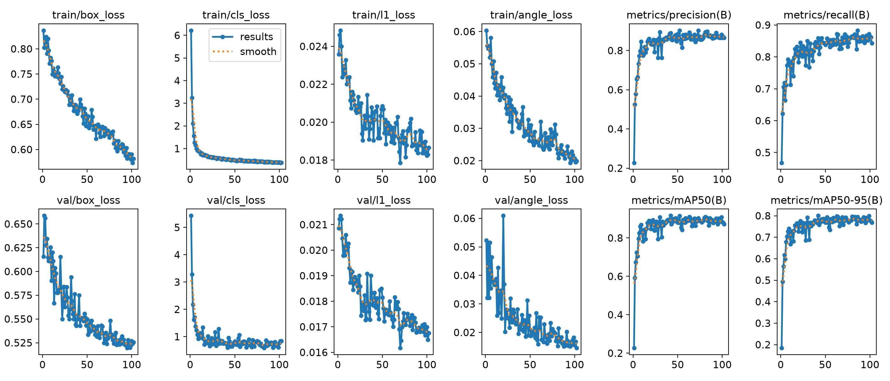

### Confusion Matrix

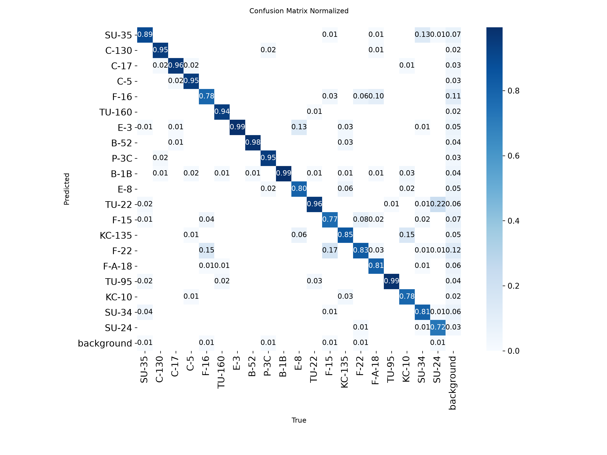

### Validation Predictions

> Hand-picked best frames from the 2,511-image val split, one per scene type: every panel below is
> 0 false positive, 0 missed aircraft and 0 misclassifications at IoU 0.5, 7 to 21 aircraft per frame, and
> a mean quad IoU of 0.84 to 0.92. Together they cover all 20 classes. The aggregate numbers above are the
> honest measure; these are the cleanest illustrations of them. Ground truth left, predictions right, all
> in `runs/obb/yolo26m-predict/preview/`.

| Scene and aircraft | Panel |
|--------------------|-------|
| F/A-18 Hornet x20, densest fighter row | 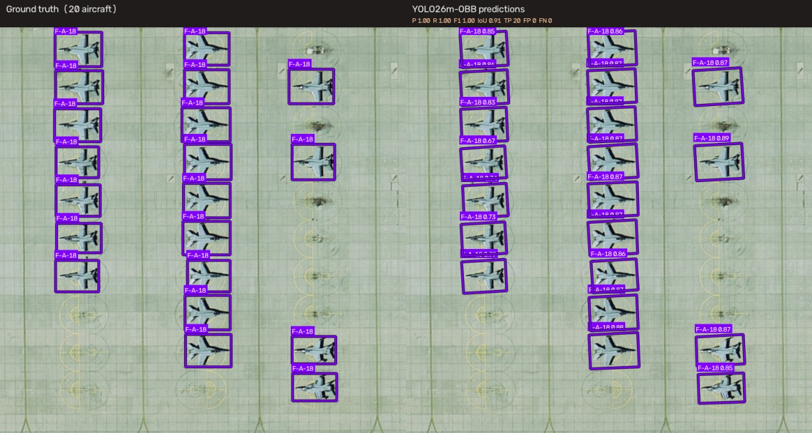 |
| C-5 Galaxy x21, biggest airlift line in the set | 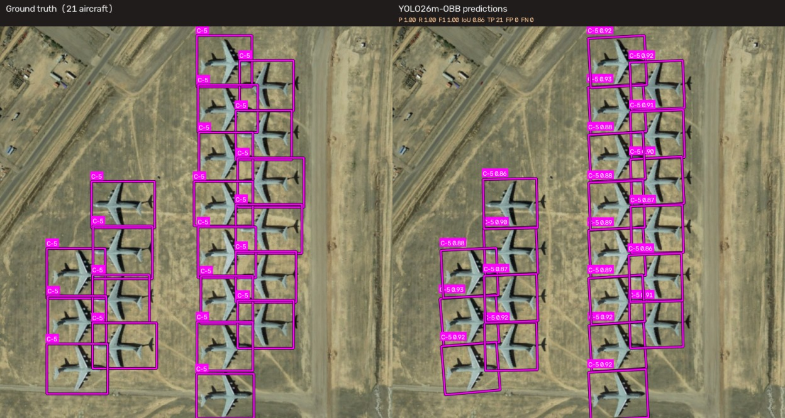 |
| SU-24 x9, SU-34 x4, SU-35 x3, mixed fighter apron | 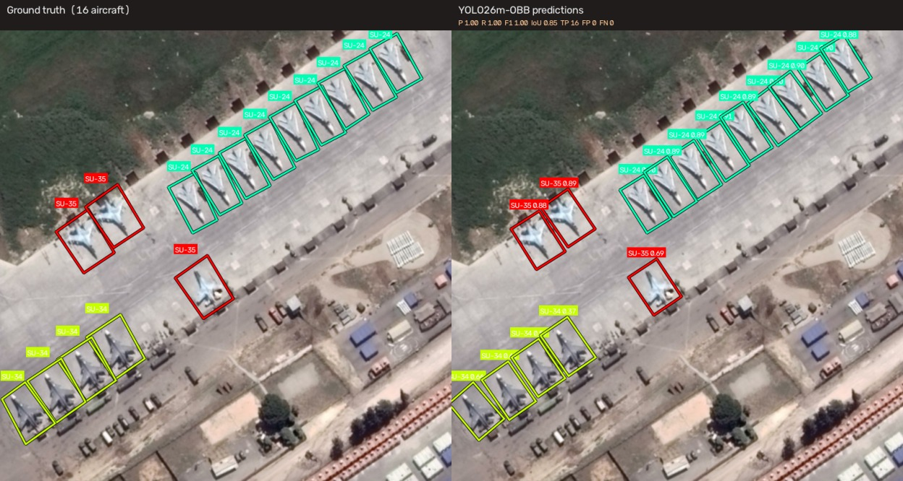 |
| TU-95 x6, TU-160 x5, TU-22 x1, strategic bombers | 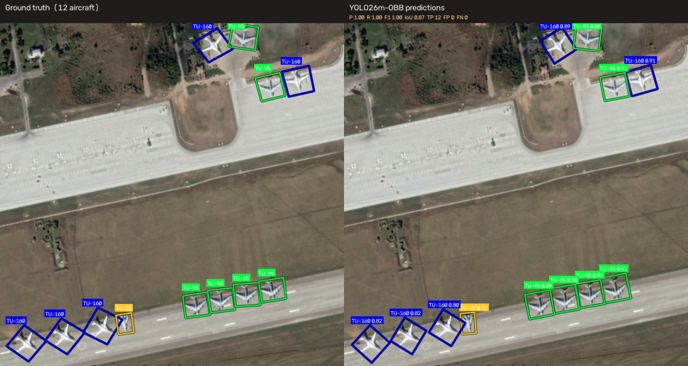 |
| F-15 x6, C-130 x2, KC-135 x2, B-52 x1, four heavy types in one frame | 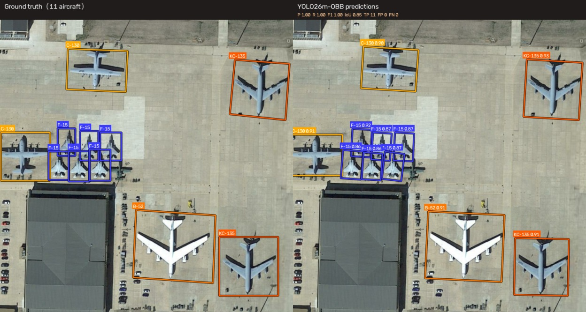 |
| KC-10 x3, KC-135 x2, C-17 x1, C-5 x1, airlift and tankers, sparse | 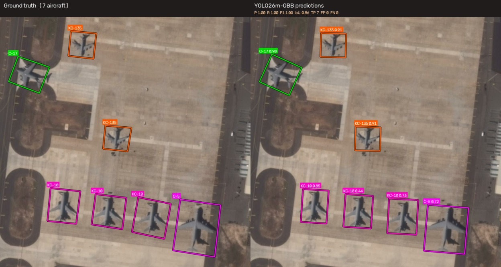 |
| E-3 Sentry x10, AWACS row | 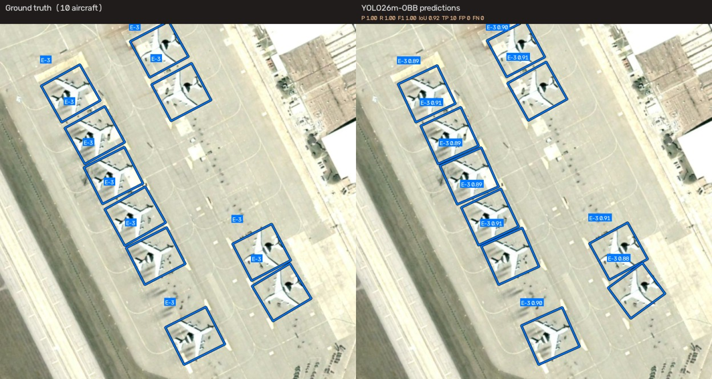 |
| B-52 x14, Stratofortress fleet | 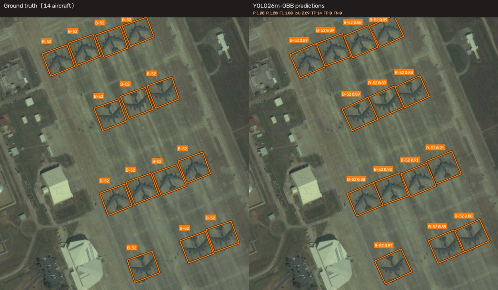 |
| F-22 Raptor x12 | 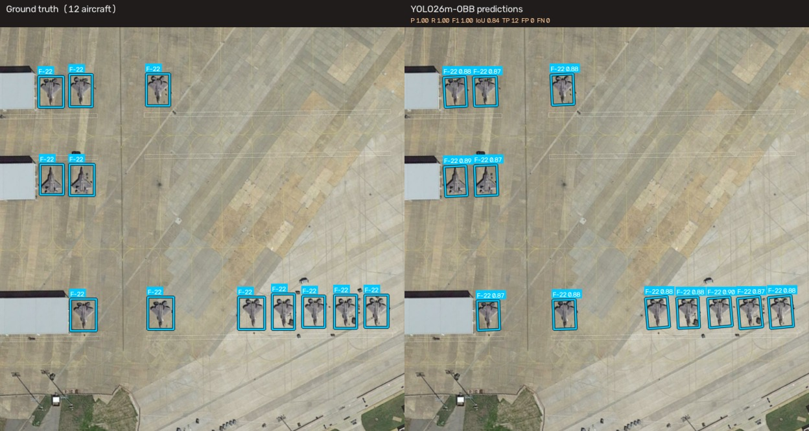 |
| F-16 Falcon x16 | 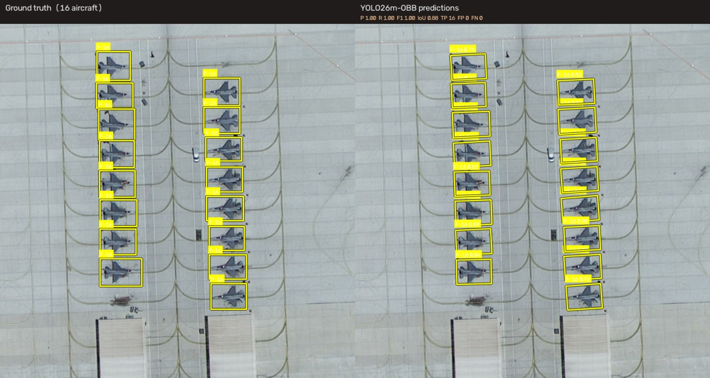 |
| E-8 JSTARS x12 | 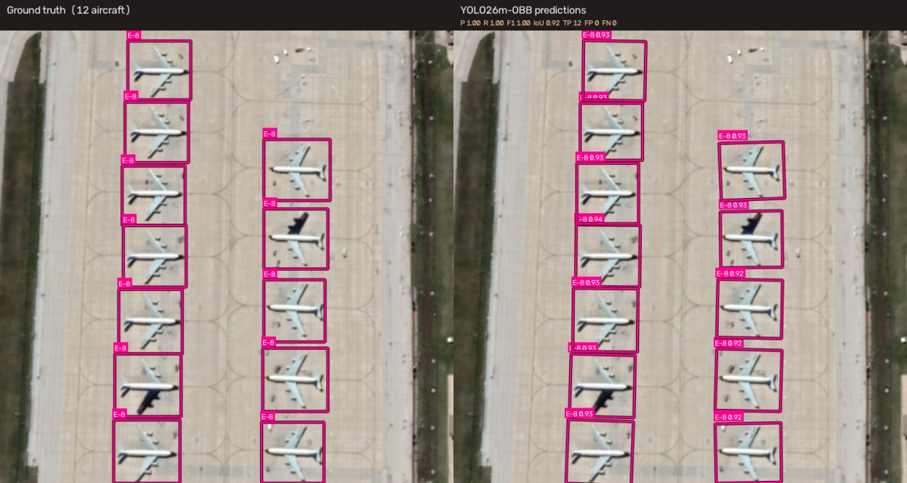 |
| B-1B Lancer x14 | 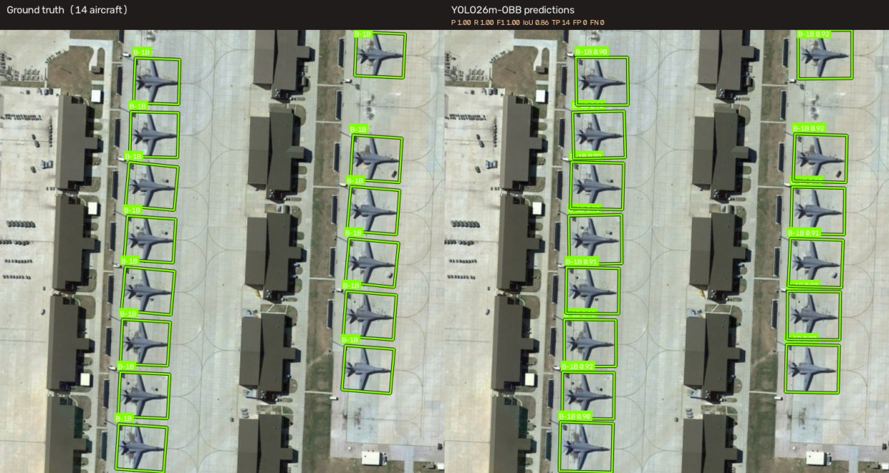 |
| P-3C Orion x16 | 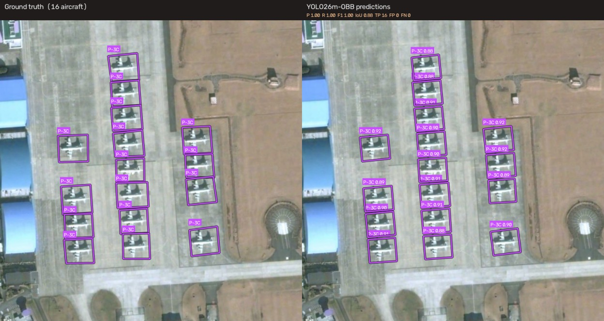 |

The last five rows are the hard-class frames: F-22 (0.615 mAP@0.5, the only class the backbone cannot
fix), F-16 (0.840), E-8 (0.866), B-1B (0.989) and P-3C (0.975). They are not the model's average behaviour
on those classes, they are what it does when the planform is clear, and they are here because panels 1-8
would otherwise leave the reader with no view of exactly the aircraft the per-class tables argue about.

The panels were scored class-aware against the val labels at IoU 0.5 (2,505 prediction files, mean image
F1 0.856, 57.7% of frames with zero FP and zero FN) and chosen for clean coverage rather than at random -
`preview/SELECTION_NOTES.md` records the selection rule, the pool stats, and the 111 frames where geometry
is right and every class is wrong.

The s run's curves and matrices stay in `runs/obb/mar20_yolo26s_l40s_1024/` for the ablation comparison.

---

## Per-Class Breakdown (YOLO26s vs YOLO26m-OBB @ 1024)

Classes grouped by the **current model's** mAP@0.5 band, with the s value and the delta alongside, so the
grouping reflects what ships as the headline and the ablation is one column away. Notes describe what the
class actually is and what the two runs did with it.

### 🟢 Strong (m mAP50 ≥ 0.90) – Large, Distinct Airframes

| Class   | m mAP50 | s mAP50 | Δ | m Precision | m Recall | Notes |
|---------|---------|---------|---|-------------|----------|-------|
| B-52    | 0.992 | 0.987 | +0.005 | 0.947 | 0.971 | Stratofortress – best class overall at this resolution |
| B-1B    | 0.989 | 0.986 | +0.003 | 0.921 | 0.991 | Lancer – swing-wing, near-perfect recall |
| TU-95   | 0.988 | 0.955 | +0.033 | 0.944 | 0.984 | Bear – swept wings + 4 turboprops, biggest gain in this block |
| C-17    | 0.986 | 0.986 | ±0.000 | 0.961 | 0.950 | Globemaster III – tight, reliable boxes |
| C-130   | 0.981 | 0.981 | ±0.000 | 0.984 | 0.919 | Hercules – balanced P/R, unchanged by the extra width |
| TU-160  | 0.978 | 0.969 | +0.009 | 0.981 | 0.920 | Blackjack – largest combat aircraft |
| C-5     | 0.976 | 0.970 | +0.006 | 0.979 | 0.924 | Galaxy – massive T-tail airlifter |
| P-3C    | 0.975 | 0.968 | +0.007 | 0.964 | 0.926 | Orion – long fuselage + 4-engine prop |
| F/A-18  | 0.953 | 0.840 | **+0.113** | 0.986 | 0.731 | Hornet – was the worst recall in the set (0.556), now 0.731 |
| E-3     | 0.950 | 0.980 | **−0.030** | 0.824 | 0.994 | AWACS – recall 0.994, but precision fell from 0.939 |
| TU-22   | 0.945 | 0.936 | +0.009 | 0.750 | 0.957 | Backfire – same mAP, operating point shifted to recall |
| SU-35   | 0.944 | 0.914 | +0.030 | 0.917 | 0.870 | Flanker-E – strongest non-F-15 fighter now |
| KC-135  | 0.944 | 0.925 | +0.019 | 0.945 | 0.834 | Stratotanker – recall 0.799 → 0.834, precision slightly down |
| SU-34   | 0.900 | 0.851 | +0.049 | 0.922 | 0.752 | Fullback – precision 0.814 → 0.922, just makes the band |

> 14/20 classes above 0.90 mAP50 on the m model (13 on s). F-15 and SU-24 left this block, F/A-18 joined it.

### 🟡 Moderate (0.85–0.90)

| Class  | m mAP50 | s mAP50 | Δ | m Precision | m Recall | Notes |
|--------|---------|---------|---|-------------|----------|-------|
| SU-24  | 0.868 | 0.927 | **−0.059** | 0.980 | 0.706 | Fencer – precision 0.980, recall collapsed 0.877 → 0.706 |
| E-8    | 0.866 | 0.847 | +0.019 | 0.784 | 0.794 | JSTARS – 356 val instances, lowest precision of the big airframes |
| F-15   | 0.851 | 0.617 | **+0.234** | 0.906 | 0.750 | Eagle – the headline per-class win; recall-heavy failure was fixable |

### 🟠 Weak (0.70–0.85)

| Class  | m mAP50 | s mAP50 | Δ | m Precision | m Recall | Notes |
|--------|---------|---------|---|-------------|----------|-------|
| F-16   | 0.840 | 0.821 | +0.019 | 0.813 | 0.763 | Falcon – still over-predicts, but precision is climbing |
| KC-10  | 0.777 | 0.774 | +0.003 | 0.809 | 0.723 | Extender – 148 val instances, carries the most val noise |

### 🔴 Poor (<0.70)

| Class  | m mAP50 | s mAP50 | Δ | m Precision | m Recall | Notes |
|--------|---------|---------|---|-------------|----------|-------|
| F-22   | 0.615 | 0.600 | +0.015 | 0.451 | 0.742 | Raptor – unmoved by 2× capacity; precision got *worse* |

> **The shape of the error, revised by the m run:** every class above 0.95 is still a distinct large airframe,
> and the flat block (C-17, C-130 and friends) says those were already solved. What changed is which fighters
> fail and how. On s the fighters failed two ways - F-15/F/A-18 by missing aircraft, F-16/F-22 by mislabelling
> them. Doubling capacity **fixed the first failure mode** (F-15 +0.234, F/A-18 +0.113) and **barely touched
> the second** (F-16 +0.019, F-22 +0.015 with precision down to 0.451). So "cannot see it" was a capacity
> problem and "cannot tell it apart" is not. F-22 is now the only class below 0.80 that the backbone cannot
> explain away, and it is a twin-tail planform problem.

---

## Why the Fighter Gap Exists

Revised after the m run's per-class pass, because one of these reasons survived and one did not.

1. **Planform similarity** – all modern fighters are single/double-seat, swept-wing, single/double-tail. The difference between an F-16 and SU-35 from 800 km up is a few pixels of wing sweep.
2. **Scale, split into two failure modes** – fighters are 15–20 m long, ~48×48 px at 1024. Quadrupling capacity (n → s) left F-15 at 0.617 and F-22 at 0.600, which looked like a data limit. Doubling again (s → m) **proved that wrong for F-15**: 0.617 → 0.851, recall 0.521 → 0.750, precision 0.723 → 0.906. F/A-18 did the same, 0.840 → 0.953. So "the detector never fires on that aircraft" was a capacity problem after all. F-22 is the exception that stayed put: 0.600 → 0.615, precision 0.493 → 0.451. Capacity fixed *finding* fighters, not *identifying* them.
3. **Feature asymmetry** – the model learns strong features for bombers (wing config, engine count, size) that don't exist for fighters.
4. **Not data starvation** – at 1024 the correlation between class instance count and mAP@0.5 is **−0.055**. F-22 has 418 val instances and scores 0.615; TU-160 has 334 and scores 0.978. The difference tracks how distinguishable the airframe is, not how many examples exist.
5. **Operating point, now mostly resolved** – on s, F-15 (P 0.723 / R 0.521) and F/A-18 (P 0.974 / R 0.556) were recall-limited and a per-class threshold was the cheap fix. On m both are re-centred (F-15 P 0.906 / R 0.750, F/A-18 P 0.986 / R 0.731), so calibration is no longer where the remaining error lives. F-22 (P 0.451 / R 0.742) is the one class still precision-limited by identity rather than by threshold.

Resolution and rotation lifted the borderline classes in phase 2, and the extra capacity in phase 1 then
rescued the two recall-limited fighters (s → m: F-15 +0.234, F/A-18 +0.113). But neither pixels nor
parameters moved F-22 off 0.615, and the last rung was not free: SU-24 gave back 0.059 and E-3 0.030. The
honest form of the claim now: **the fighter gap is one class, not a block.**

---

## Architecture Strategy

**Phase 1 – Scale up YOLO26-OBB:** done, three rungs. YOLO26s-OBB (10.54 M params) at 1024 with rotation
augmentation reaches mAP@0.5 0.8914 / mAP@0.5:0.95 0.7862, beating YOLO26n-OBB trained with the identical
command on every metric (+0.0206 mAP@0.5, +0.0378 precision, +0.0197 recall). YOLO26m-OBB (21.21 M params,
2× L40S) then adds **+0.0246 mAP@0.5 / +0.0141 mAP@0.5:0.95**, reaching **0.9160 / 0.8003**. The ladder is
monotonic and each rung moves every aggregate metric, so at 1024 px accuracy is still capacity-bound rather
than resolution-bound. The per-class pass says where it went: fighter mean mAP@0.5 0.720 → 0.815, non-fighter
mean 0.935 → 0.941. The gap is now one class (F-22 at 0.615), not a block.

**Phase 2 – Resolution and augmentation:** done. `imgsz 1024` plus `degrees 180` is the recipe for all three
runs; the pixel budget is what let the small classes move at all, and the identical command on
nano confirms the gain tracks capacity as well as pixels – resolution is a multiplier on the parameters you
already have. It stopped being the binding constraint somewhere between s and m: the m model gained without
any change in pixels, so more input size is not the next lever.

**Phase 3 – Edge deployment and benchmarking:** YOLO26s-OBB (10.54 M) is the deliverable: the target is an
**NVIDIA Jetson Orin Nano 8GB** and 8 GB of shared memory is the binding constraint before compute is. FP16
TensorRT at batch 1 is the variant most likely to fit comfortably. YOLO26m-OBB is 2× the parameters and
3.3× the FLOPs of s, which is why m is the accuracy ceiling for the paper and s stays the thing that ships.

| Stage       | Model                          | Role                                              | Status        |
|-------------|--------------------------------|---------------------------------------------------|---------------|
| Scaled      | YOLO26n-OBB @ 1024 + rot aug   | NMS-free head, small-object regression, capacity check | ✅ mAP50 0.871 / 0.762 (level 0.853 / 0.747) |
| Scaled      | YOLO26s-OBB @ 1024 + rot aug   | Width step; cheapest good model, edge candidate | ✅ mAP50 0.891 / 0.786 (level 0.866 / 0.763) |
| **Current** | **YOLO26m-OBB @ 1024 + rot aug (2× L40S)** | **Accuracy ceiling; headline model for the paper** | ✅ **mAP50 0.916 / 0.800 (level 0.889 / 0.779)** |
| Deployment  | YOLO26s-OBB on Jetson Orin Nano | TensorRT export, on-device benchmark + paper      | ⬜ Next |

---

## Edge Deployment (Jetson Orin Nano 8GB)

The trained 1024 px YOLO26s-OBB checkpoint is the deliverable; the deployment target is an NVIDIA Jetson
Orin Nano 8GB (Ampere, 1024-core GPU, 6-core ARM Cortex-A78AE, 8 GB shared LPDDR5 at 68 GB/s). YOLO26m-OBB
is not the edge target (21.21 M params, 71.9 GFLOPs, 3.3× the s model's compute on a 68 GB/s memory bus);
it exists to show how much accuracy the 1024 recipe has left in it and to give the paper a ceiling to
compare s against.

Planned benchmark matrix – same 2,511-image val split, accuracy must match the desktop numbers reported
above. No desktop latency reference exists at 1024 yet; the L40S figure is training-card only, so the first
measured baseline will come from the Jetson run itself.

| Variant | What it measures |
|---------|------------------|
| PyTorch FP32 (`best.pt`) | Baseline, no optimisation |
| ONNX Runtime | Export portability, CPU/GPU EP |
| TensorRT FP16 | Realistic edge latency |
| TensorRT INT8 (calibrated on MAR20) | Throughput ceiling vs. mAP loss |

Metrics to report per variant: per-image latency (pre/inference/post split), FPS at batch 1, mean
power draw and energy per frame (`jtop`), peak memory, thermal throttling over a sustained run, and
mAP@0.5 / mAP@0.5:0.95 parity against the desktop checkpoint.

---

## Next Steps

The accuracy ceiling is YOLO26m-OBB at 1024 with rotation augmentation: **0.9160 mAP@0.5 / 0.8003
mAP@0.5:0.95** at `best.pt` (epoch 42 of 102), with a 60-epoch level of 0.8887 / 0.7786. The edge candidate
is still YOLO26s-OBB (0.8914 / 0.7862) at 2× fewer parameters. What remains is deployment, evaluation
hygiene, and writing.

1. **Export and benchmark on Jetson Orin Nano 8GB** – s `best.pt` → ONNX → TensorRT FP16/INT8, measure
   latency, FPS, power, and memory per variant.
2. **Validate on-device accuracy parity** – run the same val split on the Jetson at 1024; any mAP loss from
   FP16/INT8 quantisation is the headline trade-off, and 8 GB of shared memory is the likely binding
   constraint before compute is.
3. **Write the short paper** – YOLO26n/s/m on MAR20 (the n → s → m capacity ladder, both per-class tables) and
   the Jetson Orin Nano benchmark suite (accuracy / latency / power), quoting the exact commands from
   "Reproducing the reported runs" and the measurement caveats above.
4. **Prove gains with seeds, not single runs** – every number here is one run. Re-run the 1024 config 2–3
   times with different seeds and report mean ± std before claiming the +0.0206 and +0.0246 steps are
   settled. The m run's single best epoch (42 of 102) is the weakest link: 0.9160 peak against a 0.8887
   level is the largest peak-selection gap of the three.
5. **Explain the SU-24 and E-3 regressions** – SU-24 lost 0.059 mAP@0.5 (recall 0.877 → 0.706) and E-3 lost
   0.030 (precision 0.939 → 0.824) going s → m. Both are larger than the s run's epoch jitter. Either they
   are seed noise (so a second seed settles it) or the wider backbone is trading those classes for the
   fighter gains, which is a paper-worthy finding rather than a defect.
6. **F-22 targeted work** – now the single weakest class at 0.615 and the only one 2× capacity did not move
   (precision actually fell 0.493 → 0.451). More pixels and more parameters both failed, so the remaining
   levers are hard-negative mining against the other twin-tail fighters or an upstream crop-and-reclassify
   stage.
7. **Per-class confidence calibration** – still cheap, but its target changed: F-15 and F/A-18 are already
   re-centred on m, so the classes left sitting on a bad operating point are F-22 (P 0.451 / R 0.742),
   TU-22 (P 0.750 / R 0.957), SU-34 (P 0.922 / R 0.752) and KC-10 (P 0.809 / R 0.723). Tune per class and
   re-report.

---

## Files

| File | Purpose |
|------|---------|
| `train_yolo_obb.py` | Conversion + training. Defaults to `yolo26n-obb.pt`, `--epochs 100`, `--patience 20`, `--batch 16`, `--imgsz 640`. Also passes through `--cache`, `--cos-lr`, `--degrees`, `--close-mosaic`, `--lr0`, `--optimizer`, `--seed`, `--no-amp`, `--rect`; `--model` selects another YOLO26-OBB variant |
| `test_model.py` | Validation, single-image prediction, batch inference on any YOLO26-OBB checkpoint (`--model` to choose). Reads `imgsz` from the run's `args.yaml` (override with `--imgsz`) |
| `benchmark_detection.py` | Class-agnostic detection benchmark (IoU / centre-offset / angle error, conf sweep) on any YOLO26-OBB checkpoint |
| `runs/obb/mar20_yolo26m_l40s_1024/` | **Current model, accuracy ceiling** – YOLO26m-OBB @ 1024 with rotation augmentation, trained on 2× L40S (`--device 0,1`). Curves, confusion matrix, val batches, `args.yaml`, `results.csv` (per-epoch metrics), `best.pt` = epoch 42 |
| `runs/obb/mar20_yolo26s_l40s_1024/` | YOLO26s-OBB @ 1024 with rotation augmentation – the mid rung of the ladder and the Jetson candidate, 2× fewer params than m. Curves, confusion matrix, val batches, `best.pt` (weights git-ignored) |
| `runs/obb/mar20_yolo26n_l40s_1024/` | YOLO26n-OBB @ 1024 with rotation augmentation – the small-capacity ablation, same command, `best.pt` = epoch 108 |
| `runs/obb/yolo26m-predict/` | Val-split predictions of the current model (`batch/labels/*.txt`, one file per val image) plus `preview/`, the 13 rendered Validation Predictions panels, their two-column variants and `SELECTION_NOTES.md` |
| `logs/train_l40s_1024.log`, `logs/val_1024.txt` | Full training transcript and final validation output for YOLO26s |
| `logs/val_1024_yolo26m.txt` | Standalone `test_model.py --val` output for YOLO26m `best.pt` – the per-class table quoted in this README (Ultralytics 8.4.202, L40S, 1024 px) |
| `yolo_obb_dataset/mar20_obb.yaml` | Dataset config (auto-generated, path fixed to this checkout) |

---
*Built with [Ultralytics YOLO26](https://docs.ultralytics.com/) on the MAR20 dataset.*
